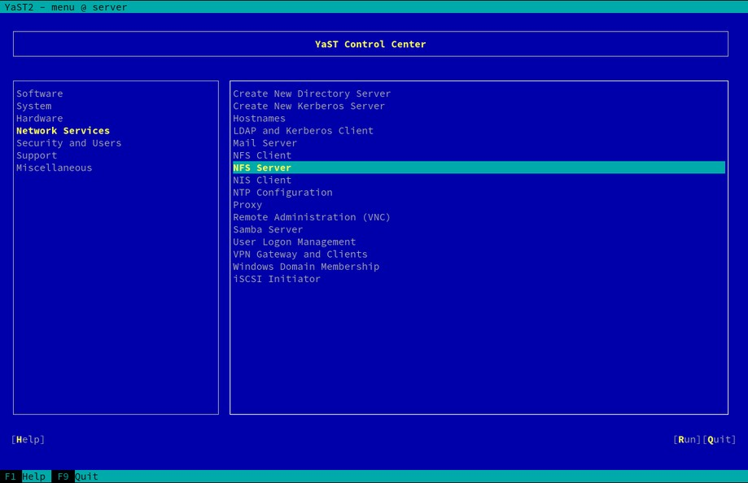
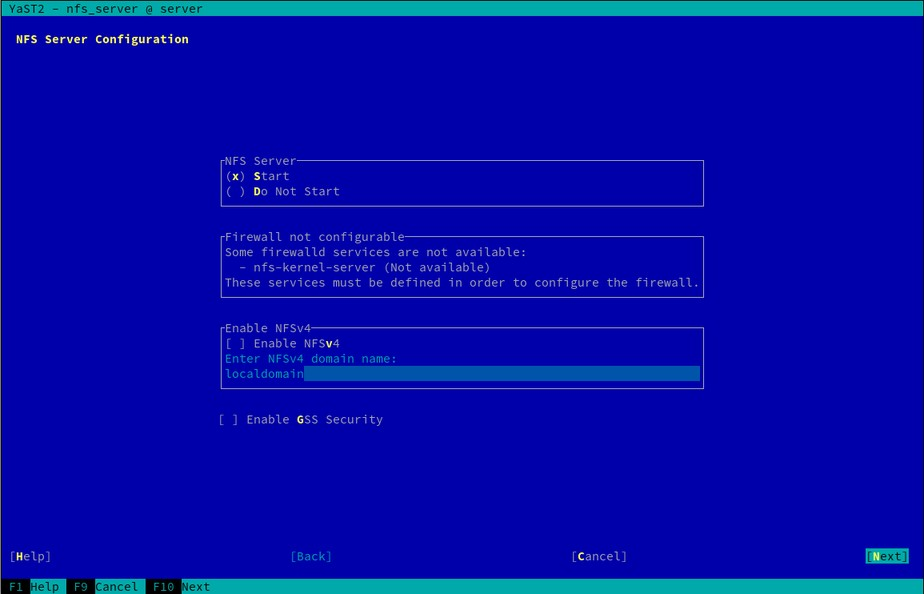
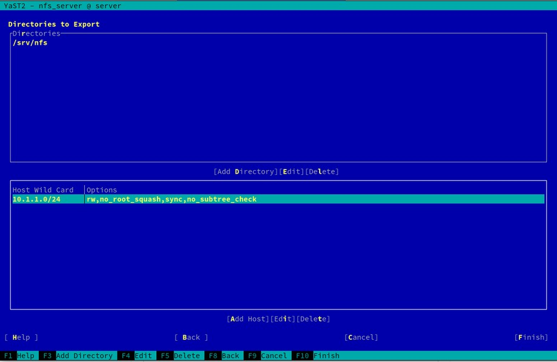
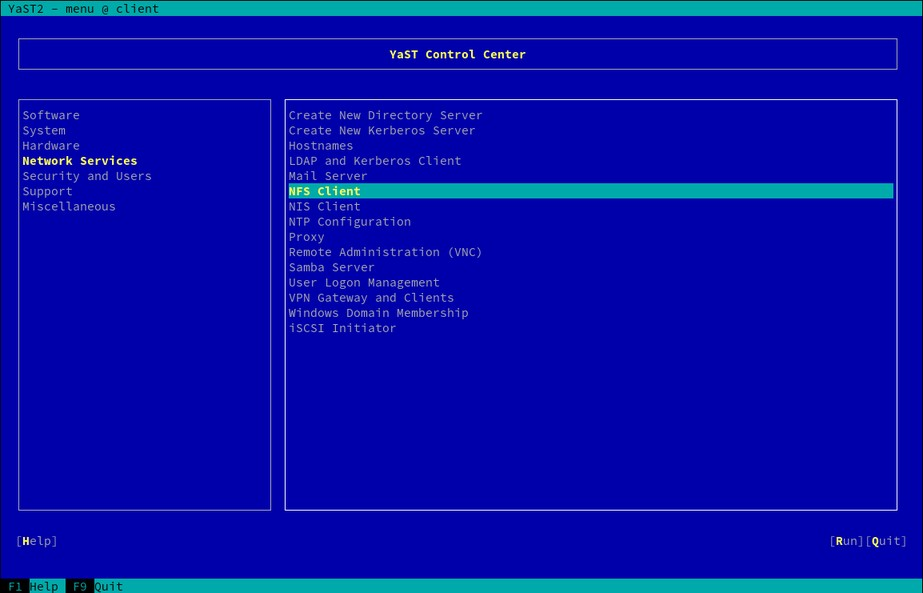
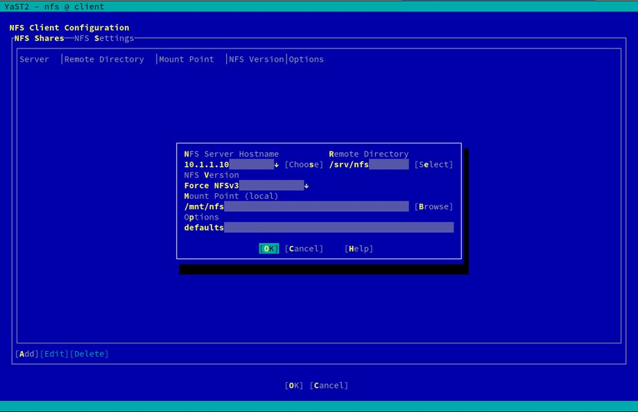

In 2019 almost everyone has a digital life, so as I. Having digital photos or videos taken with our smartphones is an every day action.
Year by year the number of smart phones and computers rises in households. Files started to be found everywhere. In your computers, in the cloud, everywhere
Why do not we store them in one place and access them from everywhere?


I wanted to create a file server providing a central location for all our digital data. Creating an NFS file server looked promising.

A file server I present here is a technical solution to solve some of the problems. This could be achieved by using an off-the-shelf product which may even have a user friendly web interface. However I decided to create my own from scratch. But how can I access the contents on a desktop computer, on a laptop, on smartphones, on TV?

I could choose from many options, but as most of the devices we have at home runs Linux, therefore I chose NFS (v3) <sup>1</sup>.

### Advantages of NFS

- I consider it easy to set up on server side.

- Almost all client devices supports it.

- The performance overhead of NFS is less than CIFS'. <sup>2</sup>

### Disadvantages of NFS

- The data connection is not encrypted by default.

- Using a firewall to filter NFS is not trivial.

- Access rights are limited to standard UNIX file and directory access by default.

- Depending on settings a network issue could cause either blocking I/O or data loss.

These compromises are acceptable for me because the network it operates in is limited to one household with limited number of users having access to it.

<sup>1</sup> Note: Using NFSv4 was not important, because not all of the devices do support it. Also I did not wanted to set up Kerberos just to have encrypted communication.
<sup>2</sup> Note: The question of performance overhead comes from the ancestors of different hardware I used in the past for the same purpose. The hardware what I use now has more resources, so this is not a hard requirement anymore.

## Creating an NFS server

The guide below uses YaST, a SUSE specific system configuration tool. You should issue the commands below on openSUSE or SLES. The methods may vary on different Linux distributions. At the end of this chapter I will show a manual installation method as well.

### Installing the service

Every code block contains information about the system the command needs to be issued on. For example in this case "test@server" represents the user "test" on a system whose host name is "server".

```bash
test@server:~> sudo zypper ref
test@server:~> sudo zypper in -y yast2-nfs-server
test@server:~> sudo yast
```

The screenshots below show the steps you should take one after the another in YaST's console interface.

  

To commit the changes, press **Finish** and **Quit**.

#### Manual installation method

In case you do not like YaST or use a different distribution, then the following commands could help you.

```bash
test@server:~> sudo zypper ref
test@server:~> sudo zypper in -y nfs-kernel-server
test@server:~> sudo systemctl enable nfsserver.service
test@server:~> sudo systemctl start nfsserver.service
test@server:~> sudo echo "/srv/nfs 10.1.1.0/24(rw,no_root_squash,sync,no_subtree_check)" >> /etc/exportfs
```

### Network and firewall settings

In the server there are two network interfaces, each belong to a different firewall zone. By default the NFS service is only accessible from the zone called **internal**.

In case you do not want to use multiple zones then you can omit it completely and the default zone will be used which is **public**.

I use the following zone and network details.

| **Host** | **Interface** | **Zone** | **IP CIDR** |
| --- | --- | --- | --- |
| server | eth0 | public zone | n/a |
| server | eth1 | internal zone | 10.1.1.10/24 |
| client | eth0 | internal zone | 10.1.1.20/24 |

In case your **interface→zone** assignment is different, you can used the following example to rearrange the interfaces between zones.

```bash
test@server:~> sudo firewall-cmd --remove-interface=eth1 --zone=public --permanent
test@server:~> sudo firewall-cmd --add-interface=eth1 --zone=internal --permanent
```

In order the clients could access the NFS service behind the firewall we need to open up ports. Some components like *mountd* of NFS service binds to random ports upon start. To make it more firewall friendly, we should fix its port number to TCP 20048 <sup>1</sup>.

<sup>1</sup>Note: TCP 20048 comes from the default *moundt* service installed by firewalld. I think it is easier to change the configuration of *mountd* than maintaining a firewalld service XML.

```bash
test@server:~> sudo sed -i 's/MOUNTD_PORT=""/MOUNTD_PORT="20048"/' /etc/sysconfig/nfs
test@server:~> sudo systemctl restart nfs-mountd
test@server:~> sudo firewall-cmd --add-service=nfs --add-service=mountd --add-service=rpc-bind --zone=internal
test@server:~> sudo firewall-cmd --add-service=nfs --add-service=mountd --add-service=rpc-bind --zone=internal --permanent
```

Verifying zones:

```bash
test@server:~> sudo firewall-cmd --list-all --zone=internal
internal (active)
target: default
icmp-block-inversion: no
interfaces: eth1
sources:.
services: ssh mdns samba-client dhcpv6-client nfs mountd rpc-bind
ports:.
protocols:.
masquerade: no
forward-ports:.
source-ports:.
icmp-blocks:.
rich rules:.
```

Note the difference in the name of the host. The following output is from the client and not from the server.

```bash
test@client:~> sudo firewall-cmd --list-all --zone=internal
internal (active)
target: default
icmp-block-inversion: no
interfaces: eth1
sources:
services: ssh mdns samba-client dhcpv6-client
ports:
protocols:
masquerade: no
forward-ports:
source-ports:
icmp-blocks:
rich rules:
```

### Client side settings

We can use YaST here too to set up a permanent NFS import on a client system. Check the screenshots to have guidance in YaST.

```bash
test@client:~> sudo yast
```

 

You can check the import by looking up the output of **mount** or use these commands below to do manual testing.

```bash
test@client:~> sudo showmount -e 10.1.1.10
[sudo] password for root:
Export list for 10.1.1.10:
/srv/nfs 10.1.1.0/24
test@client:~> sudo mkdir -p /mnt/nfs
test@client:~> sudo mount -t nfs 10.1.1.10:/srv/nfs /mnt/nfs
test@client:~> touch /mnt/nfs/write_test
test@server:~> cat /srv/nfs/write_test
```

Please notice that the last command should be issued on the server and not on the client.

## Further steps

This tutorial does not solve some problems.

1. For instance, YaST creates a permanent import for the NFS export in /etc/fstab. This configuration is not flexible enough. This could cause boot lockups or very slow boot, because modern clients may change network state too often.

1. Our users may be are not qualified enough to set up an NFS import on their own.

I will [fix these problems by using autofs](/2019/01/01/mounting-nfs-exports-by-using-autofs/) in the next post.

In case you would like to read more about NFS and openSUSE, you should check their [manual](https://doc.opensuse.org/documentation/leap/reference/html/book.opensuse.reference/cha.nfs.html).

You can find other posts about my [DIY home server](/tag/diy_home_server/) on my blog. If you liked this guide then please check the other [tutorials](/tutorials/) and share the post on any social system you prefer.

Thank you.
