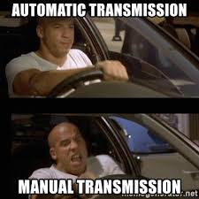

When I created a [central file sever](/2018/12/21/creating-a-file-server/), I mentioned that some of the problems with the solution are yet to be resolved.

 

1. YaST created an import rule in file /etc/fstab, which is the de-facto place for storing such information. Its content and the mounts are usually static in server environments. On most client (in term of using an export of an NFS server) the network connectivity rarely or never changes in traditional environments.
However in case of mobile devices like on laptops, the network state could vary a lot. It can be offline, or on WiFi, or on wired connection, maybe using VPNs. We need much more flexibility than a mostly static file.

1. Users would like to mount exports on their own. The system should be as transparent as possible to the end users.

Lucky for us, mounting NFS exports by using [autofs](https://access.redhat.com/documentation/en-us/red_hat_enterprise_linux/7/html/storage_administration_guide/nfs-autofs) service help us and gives the following advantages too. 

- Exports are going to be mounted on demand.

- When they are idle for a while they get unmounted automatically.

- It is completely transparent for the end user.

The service of course is capable to do other things - see link above - but in this example I only use these features. Let's see how.

## Installation and setup

Install the service in case it has not been installed yet.

```bash
test@client:~> sudo zypper in -y autofs
```

Follow these steps below to set up the mounts.

1. Make sure that in the file **/etc/auto.master** the line which enables including configuration snippets from the directory **/etc/auto.master.d/** is <span style="text-decoration: underline;">not</span> commented out. Also make sure that directory exists. Example below:

```bash
test@client:~> cat /etc/auto.master
#
# Sample auto.master file
# This is a 'master' automounter map and it has the following format:
# mount-point [map-type[,format]:]map [options]
# For details of the format look at auto.master(5).
#
#/misc	/etc/auto.misc
#
# NOTE: mounts done from a hosts map will be mounted with the
#	"nosuid" and "nodev" options unless the "suid" and "dev"
#	options are explicitly given.
#
#/net	-hosts
#
# Include /etc/auto.master.d/*.autofs
# The included files must conform to the format of this file.
#
+dir:/etc/auto.master.d
#
# Include central master map if it can be found using
# nsswitch sources.
#
# Note that if there are entries for /net or /misc (as
# above) in the included master map any keys that are the
# same will not be seen as the first read key seen takes
# precedence.
#
```

We need this line "**+dir:/etc/auto.master.d**" but without the quotes. The advantage of this "include thing" comes handy in case of configuration management, because changes are more visible and easier to maintain for example in case of an update.

1. You should create the file **/etc/auto.master.d/share.autofs** which has the following content.

```
/- /etc/share.auto --timeout=120
```

From the left.
The "/-" means that we use direct mapping. Autofs uses absolute paths for mounting.
The service stores these maps of shares and mount points in the map file. In this example the name of the map file is **share.auto**.
The option "timeout" means that every mount point after being idle for 120 seconds will be unmounted automatically.

1. The map file's content looks like this.

```
test@client:~> cat /etc/share.auto
/home/test/NFS/share/ 10.1.1.10:/srv/nfs
test@client:~>
```

An absolute path on the left and the export on the right. It is pretty simple.

1. Before we commit the changes, let's make sure the paths above do exist.

```bash
test@client:~> mkdir -p /home/test/NFS/share
test@client:~> sudo systemctl enable --now autofs
```

You can configure to mount exports automatically by following these steps. The actual mount will occur only in cases where we access the mount point **/home/test/NFS/share** for example by browsing them in a file manager or from command line. Unmounting the export will occur after it was being idle for 120 seconds.

## Final words

As far as I know you can use autofs with other file systems not just NFS.
A possible place for improvement is to convert the current solution from NFS to CIFS by making minimal changes to the configuration so the end user will notice possible nothing from the migration.

I created more articles about my [DIY home server](/tag/diy_home_server/). You should check them out.

If you liked the content then please share it with others.

Thank you!
