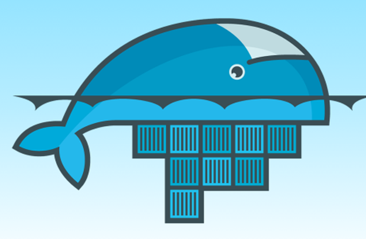

I already had plans to write about Docker. However a recent system update caused issues and Docker failed to restart. This service outage made me think and write about such a typical maintenance task.

 

I know that I created the issue at the first place. However I could fix it and I will show you how I did it and how can I avoid that in the future.

**Update on 02/25/2019:** Apparently planned changes in Docker packaging lead to the issues I experienced. I could find references to this breaking change in [Docker 18.09 Release Notes](https://docs.docker.com/engine/release-notes/#18090). I would like to emphasize that the change was announced to 18.09 but I ran into the issue with version 18.06!

> 'In Docker versions prior to 18.09, containerd was managed by the Docker engine daemon. In Docker Engine 18.09, containerd is managed by systemd.

Splits “engine”, “cli”, and “containerd” to separate packages, and run containerd as a separate systemd service [docker-ce-packaging#131](https://github.com/docker/docker-ce-packaging/pull/131), [docker-ce-packaging#158](https://github.com/docker/docker-ce-packaging/pull/158)'

## Introduction to the server environment

Before I go into details about why Docker failed to restart after upgrade I share some details. My [DIY home server](/2019/01/11/docker-failed-to-restart-after-upgrade/) does not just work as [a file server](/2018/12/21/creating-a-file-server/) but it is also home for several Docker containers. I may write about those containers later but this time I stick to the outage.

It is good to know that running containers in production usually happens on dedicated hosts. Those hosts usually runs a purpose built operating systems like CoreOS. Mostly management services or agents shall run on those hosts, plus the containers of course. This simplifies operations and could reduces risks like upgrading a service fails because of a manual change in a dependency chain.

Now let's see a case how such a manual change could lead to outages like Docker failed to restart after an upgrade.

## Details and consequences about the upgrade

On [my home server](/tag/diy_home_server/) I use [openSUSE Leap 15](https://balagetech.com/en/tag/opensuse-en/) as an operating system. It had Docker 17.09.1 before the upgrade. The package is from the official repository of the distribution and are not from Docker's repository. This is more convenient for me. I experienced instability before because of the frequent version bumps with upstream packages.

The recent upgrade involved a version bump from 17.09.1 to 18.06.1. The zypper package manager even notified me about that the upgrade will stop running containers.

```
Overall download size: 68.4 MiB. Already cached: 0 B. After the operation, additional 69.9 MiB will be used.
Continue? [y/n/...? shows all options] (y): 
Updating docker will restart the docker service, which may stop some of your docker containers. Do you want to proceed with the update?
Continue? [yes/no] (yes):
```

### Troubleshooting the service outage

After the upgrade I rebooted the machine and waited. The the containers should automatically start because of the restart policy I set. However even after 15 minutes they were not running. I checked the status of docker.service and the logs of the service to find out what may have happened.

```bash
test@server:~> sudo journalctl -u docker --since=today| tail -n34
Jan 05 15:07:20 microchuck systemd[1]: Stopping Docker Application Container Engine...
Jan 05 15:07:20 microchuck dockerd[3166]: time="2019-01-05T15:07:20.605782526+01:00" level=info msg="Processing signal 'terminated'"
Jan 05 15:07:20 microchuck dockerd[3166]: [05-Jan-2019 15:07:20] NOTICE: Terminating ...
Jan 05 15:07:20 microchuck dockerd[3166]: [05-Jan-2019 15:07:20] NOTICE: Terminating ...
Jan 05 15:07:20 microchuck dockerd[3166]: [05-Jan-2019 15:07:20] NOTICE: exiting, bye-bye!
Jan 05 15:07:20 microchuck dockerd[3166]: [05-Jan-2019 15:07:20] NOTICE: exiting, bye-bye!
Jan 05 15:07:20 microchuck dockerd[3166]: 1:signal-handler (1546697240) Received SIGTERM scheduling shutdown...
Jan 05 15:07:20 microchuck dockerd[3166]: [05-Jan-2019 15:07:20] NOTICE: Terminating ...
Jan 05 15:07:20 microchuck dockerd[3166]: [05-Jan-2019 15:07:20] NOTICE: Terminating ...
Jan 05 15:07:20 microchuck dockerd[3166]: 1:M 05 Jan 15:07:20.771 # User requested shutdown...
Jan 05 15:07:20 microchuck dockerd[3166]: 1:M 05 Jan 15:07:20.933 * Calling fsync() on the AOF file.
Jan 05 15:07:20 microchuck dockerd[3166]: 1:M 05 Jan 15:07:20.933 # Redis is now ready to exit, bye bye...
Jan 05 15:07:21 microchuck dockerd[3166]: [05-Jan-2019 15:07:21] NOTICE: exiting, bye-bye!
Jan 05 15:07:21 microchuck dockerd[3166]: [05-Jan-2019 15:07:21] NOTICE: exiting, bye-bye!
Jan 05 15:07:30 microchuck dockerd[3166]: time="2019-01-05T15:07:30.640458101+01:00" level=info msg="Container 852cec6ceb2f7ea7e844226f87e5b14f72ae63fb0793de0d271b51894a>
Jan 05 15:07:30 microchuck systemd[1]: Stopped Docker Application Container Engine.
-- Reboot --
Jan 05 15:30:50 microchuck systemd[1]: Starting Docker Application Container Engine...
Jan 05 15:30:50 microchuck dockerd[1829]: time="2019-01-05T15:30:50.660394361+01:00" level=info msg="parsed scheme: \"unix\"" module=grpc
Jan 05 15:30:50 microchuck dockerd[1829]: time="2019-01-05T15:30:50.661526082+01:00" level=info msg="scheme \"unix\" not registered, fallback to default scheme" module=g>
Jan 05 15:30:50 microchuck dockerd[1829]: time="2019-01-05T15:30:50.661693268+01:00" level=info msg="ccResolverWrapper: sending new addresses to cc: [{unix:///run/contai>
Jan 05 15:30:50 microchuck dockerd[1829]: time="2019-01-05T15:30:50.661730799+01:00" level=info msg="ClientConn switching balancer to \"pick_first\"" module=grpc
Jan 05 15:30:50 microchuck dockerd[1829]: time="2019-01-05T15:30:50.661825321+01:00" level=info msg="pickfirstBalancer: HandleSubConnStateChange: 0xc4205a0140, CONNECTIN>
Jan 05 15:31:10 microchuck dockerd[1829]: time="2019-01-05T15:31:10.662356258+01:00" level=warning msg="grpc: addrConn.createTransport failed to connect to {unix:///run/>
Jan 05 15:31:10 microchuck dockerd[1829]: time="2019-01-05T15:31:10.662553437+01:00" level=info msg="pickfirstBalancer: HandleSubConnStateChange: 0xc4205a0140, TRANSIENT>
Jan 05 15:31:10 microchuck dockerd[1829]: time="2019-01-05T15:31:10.662792189+01:00" level=info msg="pickfirstBalancer: HandleSubConnStateChange: 0xc4205a0140, CONNECTIN>
Jan 05 15:31:30 microchuck dockerd[1829]: time="2019-01-05T15:31:30.663078069+01:00" level=warning msg="grpc: addrConn.createTransport failed to connect to {unix:///run/>
Jan 05 15:31:30 microchuck dockerd[1829]: time="2019-01-05T15:31:30.663325191+01:00" level=info msg="pickfirstBalancer: HandleSubConnStateChange: 0xc4205a0140, TRANSIENT>
Jan 05 15:31:30 microchuck dockerd[1829]: time="2019-01-05T15:31:30.663369093+01:00" level=info msg="pickfirstBalancer: HandleSubConnStateChange: 0xc4205a0140, CONNECTIN>
Jan 05 15:31:50 microchuck dockerd[1829]: Failed to connect to containerd: failed to dial "/run/containerd/containerd.sock": context deadline exceeded
Jan 05 15:31:50 microchuck systemd[1]: docker.service: Main process exited, code=exited, status=1/FAILURE
Jan 05 15:31:50 microchuck systemd[1]: Failed to start Docker Application Container Engine.
Jan 05 15:31:50 microchuck systemd[1]: docker.service: Unit entered failed state.
Jan 05 15:31:50 microchuck systemd[1]: docker.service: Failed with result 'exit-code'.
```

Docker service stopped before the reboot. However after the reboot it failed to start. I rebooted the system because the kernel was also updated. Details in the journal do not mean much to me. Although I noticed the line which mentions connectivity issue to a containerd socket. I know that containerd is a dependency to docker service. Let's check that socket file manually.

```bash
test@server:~> sudo ls -la /run/containerd/containerd.sock
ls: cannot access '/run/containerd/containerd.sock': No such file or directory
```

It does not exists. Maybe the containerd service is not running.

```bash
test@server:~> sudo systemctl list-unit-files | grep containerd
test@server:~> 
test@server:~> whereis containerd
containerd: /usr/sbin/containerd /etc/containerd /usr/share/man/man1/containerd.1.gz
```

There is no such service, even though the binary still exists.
Regarding the version numbers of the two Docker packages, there are more than 9 months between them. Maybe systemd starts containerd service in another way.
I started to remember that long time ago I modified the original docker.service file and it could be still active and override the default service file.
I checked the difference between the live (/etc/systemd/system/docker.service) and the factory service file installed by the upgrade (/usr/lib/systemd/system/docker.service).

```bash
test@server:~> sudo diff -u /etc/systemd/system/docker.service /usr/lib/systemd/system/docker.service 
--- /etc/systemd/system/docker.service  2018-03-19 06:52:34.796326614 +0100
+++ /usr/lib/systemd/system/docker.service      2018-12-28 22:24:44.000000000 +0100
@@ -1,8 +1,7 @@
 [Unit]
 Description=Docker Application Container Engine
 Documentation=http://docs.docker.com
-After=network.target containerd.socket containerd.service lvm2-monitor.service firewalld.service
-Requires=containerd.socket containerd.service
+After=network.target lvm2-monitor.service SuSEfirewall2.service
 
 [Service]
 EnvironmentFile=/etc/sysconfig/docker
@@ -11,7 +10,7 @@
 # enabled by default because enabling socket activation means that on boot your
 # containers won't start until someone tries to administer the Docker daemon.
 Type=notify
-ExecStart=/usr/bin/dockerd --containerd /run/containerd/containerd.sock --add-runtime oci=/usr/sbin/docker-runc $DOCKER_NETWORK_OPTIONS $DOCKER_OPTS
+ExecStart=/usr/bin/dockerd --add-runtime oci=/usr/sbin/docker-runc $DOCKER_NETWORK_OPTIONS $DOCKER_OPTS
 ExecReload=/bin/kill -s HUP $MAINPID
 
 # Having non-zero Limit*s causes performance problems due to accounting overhead
```

There are serious differences. For example the line starting with **ExecStart** shows that containerd was removed, so as **Requires**. This could explain the issue I ran into.

### The background of the manual change

There is this idea that software shipped by the distribution provides the best integration possible. For example docker.service changes the rules of iptables. Therefore Docker must start only after the firewall service has been already started. Avoiding stepping on each other's foot.

The firewall service of openSUSE was historically called SuSEfirewall2. This is visible in the line starting with "+After".

Actually that line restores the factory state I changed previously. I replaced SuSEfirewall2 by firewalld because recent versions of Leap deprecated SuSEfirewall2 in favor of firewalld. Probably firewalld is not the default because migration from SuSEfirewall2 to firewalld requires manual intervention. I assume the package maintainer wanted to stay on the safe side. The current version prevents users who did not do the migration to shoot themselves in the foot.

**Technical background info:*** Changing the factory service file located at /usr/lib/systemd/system/ puts you on risk. Any future Docker package update could overwrite it. To avoid this [systemd offers an option](https://coreos.com/os/docs/latest/using-systemd-drop-in-units.html) to override the the factory version. I used this feature to create a copy in /etc/systemd/system/ directory. This works as long as the factory version do not change much. As soon as the diverted version becomes incompatible with the update, it leads to issues like I just had.* 

## Restoring Docker service

Now we know why I had to edit the service file. I should be able to restore by applying the necessary changes to the updated factory unit and create a new copy. Here is how I did that.

-  

  - I still need the change about firewalld, but my change must be based on the new factory unit so I make a new copy of that.

```bash
test@server:~> sudo cp -v /usr/lib/systemd/system/docker.service /etc/systemd/system/
'/usr/lib/systemd/system/docker.service' -> '/etc/systemd/system/docker.service'
```

  - I will only show the difference to highlight the changes I applied.

```bash
test@server:~> sudo diff -u /etc/systemd/system/docker.service /usr/lib/systemd/system/docker.service 
--- /etc/systemd/system/docker.service  2019-01-05 15:44:36.247291736 +0100
+++ /usr/lib/systemd/system/docker.service      2018-12-28 22:24:44.000000000 +0100
@@ -1,7 +1,7 @@
 [Unit]
 Description=Docker Application Container Engine
 Documentation=http://docs.docker.com
-After=network.target lvm2-monitor.service firewalld.service
+After=network.target lvm2-monitor.service SuSEfirewall2.service
 
 [Service]
 EnvironmentFile=/etc/sysconfig/docker
```

  - Committing the changes requires a couple of commands to be issued. The first one tells systemd to reread the unit files.

```bash
test@server:~> sudo systemctl daemon-reload
test@server:~> sudo systemctl restart docker
test@server:~> sudo systemctl status docker
● docker.service - Docker Application Container Engine
   Loaded: loaded (/etc/systemd/system/docker.service; enabled; vendor preset: disabled)
   Active: active (running) since Sat 2019-01-05 15:45:38 CET; 4s ago
     Docs: http://docs.docker.com
 Main PID: 4964 (dockerd)
    Tasks: 214
   Memory: 171.9M
      CPU: 4.688s
   CGroup: /system.slice/docker.service
...
test@server:~>
```

I successfully restored the service. You could also see containers running, but I shortened the output to improve readability.

## Conclusions of the tutorial

- It is too easy to forgot about manual changes over a longer period of time. Sooner or later they could cause issues.

- A configuration management system could help to avoid situations like this one.

- I recommend to apply any updates on a test system before you apply them on production.

- Be aware of bigger version upgrades. Read the release notes before you run the upgrade process.

If you liked this post then please share it. Or should you have anything to ask or add, then please make any comments below.

Thank you!
