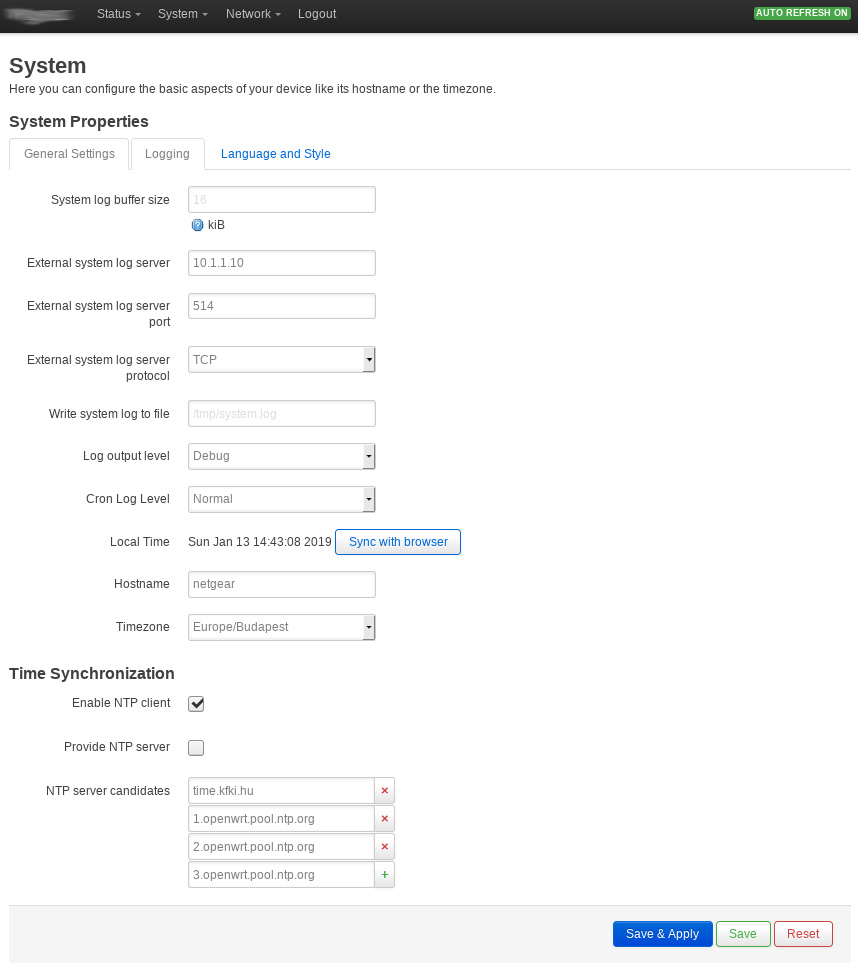

Your home network might already contain some devices or systems like a [home server](/tag/diy_home_server/), a WiFi router, a media player, or home automation system. It is a best practice creating a central syslog server and storing logs of various sources in one place.

**Update:** The fail2ban and GeoIP related contents have been merged into post [visualizing Fail2ban logs in Kibana](/2019/01/22/visualizing-fail2ban-logs-in-kibana/).

This post will cover the basics. Creating a central log server and receiving logs from an OpenWRT device. Please note that you can do many more. See the other posts I created in this subject.

- [Storing local logs of host operating system](/creating-a-central-syslog-server/#Basic_configuration),

- [Storing logs from OpenWRT based network devices](/creating-a-central-syslog-server/#Adding_OpenWRT_logs_via_network_sources),

- [Parsing Fail2ban logs to get GeoIP data](/2019/01/22/visualizing-fail2ban-logs-in-kibana/),

- [To logging Docker to Elasticsearch](/2019/02/06/simplified-logging-docker-elasticsearch-syslog-ng/),

## Log management

In reality many companies have log management solutions. It is a must have, usually it is also required by law or compliance. Creating a central syslog server on your home server has many benefits. On one hand you can get some log management skills, which you could mention in your CV. On the other hand you may find it extremely helpful for troubleshooting issues you may ran into and creating different analytics.

Log management as a concept is pretty deep. Usually it contains some of the following topics.

- Getting logs from various sources and store them in one place.

- Manage life cycle of logs by having backups, archives.

- Create alerts, analyitics or performance metrics from the logs.

- And many more.

My goal is not to have an all in one solution. Remember creating a central syslog server for a a [DIY home server](/tag/diy_home_server/) is not the same as creating one (or more) for companies.

## Create a central syslog server

All Linux distributions have a solution for storing syslogs locally. Usually it is either rsyslog or syslog-ng or maybe just systemd-journald or a mix of them. These software have different capabilities. My choice is syslog-ng but I will also utilize journald later.

Syslog-ng on openSUSE can be installed from the default repository, although it is a bit outdated and lacks some features I need. Therefore I use a third party repository to install a more recent version of it. Generally speaking it is up to you decide which version do you need. For having decent GeoIP support I recommend at least version 3.18.

```bash
test@server:~> sudo zypper ar -cfp 90 https://download.opensuse.org/repositories/home:/czanik:/syslog-ng322/openSUSE_Leap_15.1/ syslog-ng322
test@server:~> sudo zypper ref
test@server:~> sudo zypper in -y syslog-ng syslog-ng-geoip
test@server:~> sudo systemctl enable --now syslog-ng
```

Wasn't that simple? The output is slightly shortened to improve readability.

### Basic configuration

The default configuration coming with the package is pretty good and <span style="text-decoration: underline;">already covers the use case of storing the logs of the host system in textual format</span>. You will find most of your system's logs files here: **/var/log/{messages,localmessages}** ,

As we connect more systems, we will use syslog-ng configuration's include ability to extend the basic configuration. The idea behind including additional configuration parts is pretty similar to the one I did with [autofs](/2019/01/01/mounting-nfs-exports-by-using-autofs/).

I think the configuration syntax is very user friendly and the software's [admin guide](https://www.syslog-ng.com/technical-documents/doc/syslog-ng-open-source-edition/3.19/administration-guide) is also a great resource.

### Adding OpenWRT logs via network sources

One of the simplest use is to <span style="text-decoration: underline;">collecting log messages from OpenWRT devices via RFC3164 (BSD Syslog) Protocol and store them locally in textual format.</span>

I placed this configuration as **/etc/syslog-ng/conf.d/network.conf** and its content is visible below. You can find some explanation after that. Looking for a more complete version? [Download it from this GitHub repository](https://github.com/abalage/balagetech-central-syslog-server).

```
source s_network{
    network(
        ip("10.1.1.10")
        port(514)
        transport("tcp")
    );
};

destination d_network{
    file(
        "/var/log/network/$HOST/$S_YEAR.$S_MONTH.$S_DAY/messages"
        create-dirs(yes)
    );
};

log {
    source(s_network);
    destination(d_network);
};
```

Some explanation:

- We set up a source driver called "s\_network" to listen for incoming logs on the network with IP address 10.1.1.10 on TCP port 514.

- A destination driver called "d\_network" is responsible for storing the received logs on the file system.

- We connect the source and destination drivers to each other in a log path called "log".

Note: The names "s\_network" and "d\_network" can be anything, you shall use names what describes your use case better.

Note: Macros like "$S\_YEAR" and "$S\_DAY" enables you to use values from the parsed log messages in various parts of the configuration. In this example it creates file names like this: **/var/log/network/router/2019.01.13/messages** .

Do not forget to reload syslog-ng for the changes to take effect and also open up the required port on the firewall to be able to receive the logs.

```bash
test@server:~> sudo systemctl reload syslog-ng
test@server:~> sudo firewall-cmd --add-port=514/tcp --zone=internal
test@server:~> sudo firewall-cmd --add-port=514/tcp --zone=internal --permanent
```

#### Set up log forwarding on OpenWRT LuCI interface

Although you could do this in the CLI both by hand or by using UCI, I will use LuCI as a configuration interface.
You should find the logging settings under **System → System → External system log server**, which should point to your syslog-ng server.


Note: If you also change the name of your OpenWRT device, then completely reboot the device for the change to take effect, otherwise you will still found the previous name in the logs you receive regardless of the change. I am not sure whether this is the expected behavior but I have seen this many times.

## Next steps

In the next posts I will write about [how to logging Docker to Elasticsearch](/2019/02/06/simplified-logging-docker-elasticsearch-syslog-ng/). Also you can read about [how visualizing Fail2ban logs in Kibana](/2019/01/22/visualizing-fail2ban-logs-in-kibana/) can be done for instance with failed login attempts of SSH.

If you found this post helpful then please share it with others. I will highly appreciate it.

Thank you.
