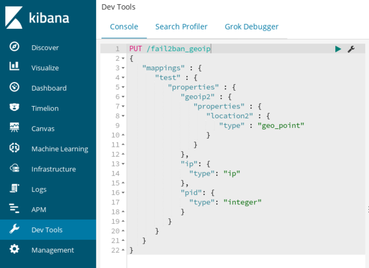
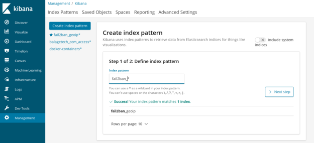
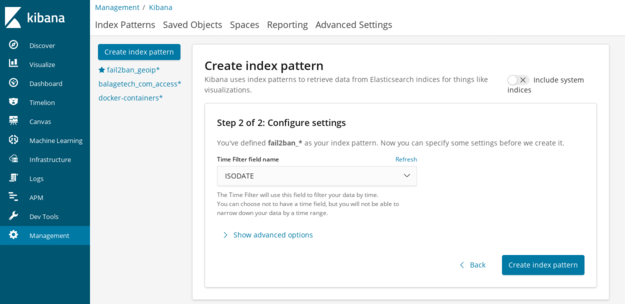
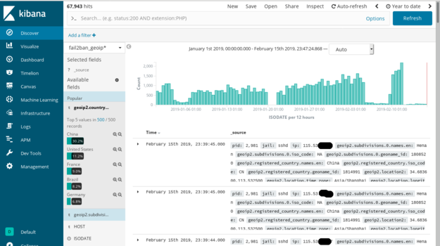
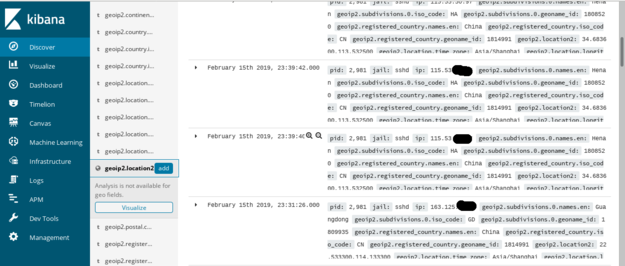
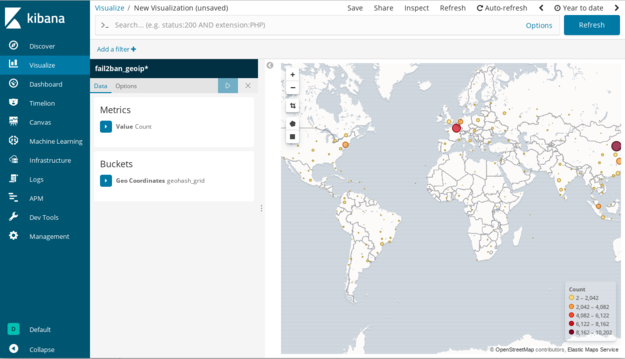

In the last post I wrote about [how you can create a central syslog server](/2019/01/14/creating-a-central-syslog-server/). This time I will show you how you can use syslog-ng to parse fail2ban log messages, enrich it with GeoIP metadata and send into Elasticsearch. You can even visualizing Fail2ban logs in Kibana to see where the failed login attempts are coming from.

**Update:** This post has been reviewed and all Fail2ban and GeoIP related contents have been merged here from the previous post. Look no further, you will find everything you need here. Note that this guide requires Elasticsearch 7.x.

This guide uses syslog-ng to transform the logs into a JSON payload enriched with GeoIP metadata. Also it can parse further meta data from logs and store them in Elasticsearch.

### Parsing fail2ban's logs to get GeoIP metadata

My [DIY home server](/2019/01/11/docker-failed-to-restart-after-upgrade/) is reachable from the public Internet and is being scanned by botnets all the time. One solution I use as a basic defense is Fail2ban. Fail2ban analyzes login attempts on SSH by parsing authentication logs of sshd. When it finds hosts with failed authentication attempts, it bans their IP addresses with the firewall for a while. It can be extended to other services too.

Some time ago, one of my friend created a post about [visualizing login attempts on a world map based on their GeoIP data](https://www.syslog-ng.com/community/b/blog/posts/creating-heat-maps-using-new-syslog-ng-geoip2-parser). His guide used iptables logs, but I wanted to use Fail2ban's logs to get the same information.

~~This use case is special as we do not use anything from the original log message except the IP address~~. The events we create will be 100% compatible with [Elasticsearch ECS](https://www.elastic.co/guide/en/ecs/current/ecs-reference.html), it will store the original message as well.

#### Setup collecting and parsing logs of Fail2ban

1. Fail2ban by default logs into a file. Although I could use that file by syslog-ng, I wanted it to log to syslog instead, so syslog-ng will get all the logs by default.
To do that I had to change "logtarget" option to "SYSLOG" in Fail2ban's configuration.
You can find that setting in file: **/etc/fail2ban/fail2ban.conf** 

```
# Option: logtarget 
# Values: [ STDOUT | STDERR | SYSLOG | SYSOUT | FILE ]  Default: STDERR
# 
#logtarget = /var/log/fail2ban.log
logtarget = SYSLOG 
```

1. As the syslog-ng configuration is lengthy I will not paste it here. You can find [the complete  configuration on GitHub](https://github.com/abalage/balagetech-fail2ban-elasticsearch/blob/master/syslog-ng/conf.d/fail2ban-geoip.conf). Save it as **/etc/syslog-ng/conf.d/fail2ban-geoip.conf**. Explanations will follow below.

1. The patterndb feature of syslog-ng will parse the logs of Fail2ban. It parses the original log message with the patterns and parsers shown below. You can se the parsed values in syslog-ng macros. The macro's name is our case is "ip" and its value is the parsed IP address. Should you want to read more about it, then check the [admin guide](https://www.syslog-ng.com/technical-documents/doc/syslog-ng-open-source-edition/3.19/administration-guide/71#TOPIC-1094735).
The [patterndb I use can be downloaded from here](https://github.com/abalage/balagetech-fail2ban-elasticsearch/blob/master/syslog-ng/patterndb-fail2ban.xml). Place it in **/etc/syslog-ng/patterndb-fail2ban.xml** 

```
<!-- https://superuser.com/questions/1018927/what-is-found-in-fail2ban-log-file -->
<?xml version='1.0' encoding='UTF-8'?>
<patterndb version="4" pub_date="2018-06-05">
  <ruleset id='c16cd58c-37d3-42c1-b7ea-50ca2e24f864' name='fail2ban-server'>
    <pattern>fail2ban-server</pattern>
    <rules>
      <rule class='violation' id='c16cd58c-37d3-42c1-b7ea-50ca2e24f864' provider='balage'>
      <description></description>
        <patterns>
          <pattern>fail2ban.filter @QSTRING:pid:[]@: INFO @QSTRING:jail:[]@ Found @IPvANY:ip@</pattern>
          <pattern>fail2ban.actions @QSTRING:pid:[]@: NOTICE @QSTRING:jail:[]@ Ban @IPvANY:ip@</pattern>
        </patterns>
      </rule>
    </rules>
  </ruleset>
</patterndb>
```

1. The GeoIP database is a snapshot. It needs to be periodically updated. I use [this SHELL script](https://github.com/abalage/balagetech-fail2ban-elasticsearch/blob/master/script/syslog-ng-update-free-geoip-db.sh) in a cronjob to periodically fetch updates and reload syslog-ng service.

```
#!/bin/bash

set -o nounset
DB="GeoLite2-City.tar.gz"

TMPDIR=$(mktemp -d)
cd ${TMPDIR}

wget -q http://geolite.maxmind.com/download/geoip/database/${DB}
wget -q http://geolite.maxmind.com/download/geoip/database/${DB}.md5

MD5SUM_CREATED=$(md5sum ${DB} | cut -d" " -f1)
MD5SUM_HOSTED=$(head -n1 ${DB}.md5)

if [ ${MD5SUM_CREATED} != ${MD5SUM_HOSTED} ]; then
    echo "md5sums do not match"
    echo "'${MD5SUM_CREATED}'"
    echo "'${MD5SUM_HOSTED}'"
    exit 1
fi
tar -xf ${DB} -C ${TMPDIR}
rm ${DB}
rm ${DB}.md5
SUBDIR=$(ls -d -- */)
cd ${SUBDIR}
cp GeoLite2-City.mmdb /etc/syslog-ng/
chown root.root /etc/syslog-ng/GeoLite2-City.mmdb
systemctl reload syslog-ng
rm -rf ${TMPDIR}
```

The crontab entry looks like this. It runs **syslog-ng-update-free-geoip-db.sh** on every Sunday at 4 AM.

```
0 4 * * 6 /usr/local/bin/syslog-ng-update-free-geoip-db.sh
```

Please note that everything can be downloaded from this [GitHub repository](https://github.com/abalage/balagetech-central-syslog-server).

## Create index template for Fail2ban in Elasticsearch

Before we do anything we need to decide how the index which stores the events would be called. In my case it is called 'fail2ban'.

Elasticsearch thanks to dynamic datatype mapping can create mappings for the ingested data. It usually implicitly assigns the [keyword](https://www.elastic.co/guide/en/elasticsearch/reference/6.5/keyword.html) data type for data. However the Coordinate Map visualization relies on a data type called **geo\_point** which must contain latitude and longitude data. This data type must be explicitly set. Also other data attributes may require explicit mapping like IP addresses, PID numbers, etc.

The following [PUT Mapping API](https://www.elastic.co/guide/en/elasticsearch/reference/current/indices-put-mapping.html) command creates the index template called **network\_fail2ban** and applies the following mapping to that.

The index pattern 'fail2ban-\*' will match logs spanning over different indexes files, all named according to the template 'fail2ban-YYYY-MM-DD'. Syslog-ng will specify this template.

```
PUT _template/network_fail2ban
{
  "index_patterns": ["fail2ban-*"],
  "settings": {
    "number_of_shards": 1
  },
   "mappings" : {
      "properties" : {
         "host" : {
            "properties" : {
               "name" : {
                  "type" : "keyword"
               },
               "ip" : {
                  "type" : "ip"
               }
            }
         },
         "source": {
           "properties" : {
              "address" : {
                 "type" : "keyword"
              },
              "ip" : {
                 "type" : "ip"
              },
              "geo.location" : {
                 "type" : "geo_point"
              }
           }
         },
         "process": {
           "properties" : {
              "pid" : {
                 "type" : "long"
              },
              "name" : {
                 "type" : "keyword"
              }
           }
         }
      }
   }
}
```

You can use the built-in Console of Kibana that you can find under **Dev Tools** to apply this command. See the screenshot from a previous version below.

The mapping must be done before the index is populated with logs. (Reindex exists but usually it requires transferring data from one index to another.)

## Send Fail2ban logs into Elasticsearch

Syslog-NG can directly send logs to Elasticsearch. The log format I use comply to [ECS](https://www.elastic.co/guide/en/ecs/current/ecs-field-reference.html) standard. **Without the need for Beats or Logstash!** The [configuration file](https://github.com/abalage/balagetech-fail2ban-elasticsearch/blob/master/syslog-ng/conf.d/fail2ban-geoip.conf) uses elasticsearch-http destination driver to send logs to Elasticsearch.

## Create index patterns in Kibana

To be able to **Discover** all the details of the logs, we must instruct Elasticsearch to create an index pattern for Kibana in advance of receiving any events.

Rememer the <span style="text-decoration: underline;">index template</span> above used <span style="text-decoration: underline;">index patterns</span> to match <span style="text-decoration: underline;">indexes</span>. Kibana <span style="text-decoration: underline;">index patterns</span> will match the <span style="text-decoration: underline;">index names</span> and creates mappings for the contents as well. Take a minute to digest this information.

You either need to create an index pattern manually the way it is described below or [import all the patterns, visualizations and dashboards](https://github.com/abalage/balagetech-fail2ban-elasticsearch/blob/master/elasticsearch/fail2ban.ndjson) from my repo. You can import them in **Management → Kibana → Saved objects → Import**.

To create an index pattern manually, go to **Management → Kibana → Index patterns → Create index pattern**.

1. Type in the index name **fail2ban-\*** and click **Next step**.[](/assets/uploads/2019/02/kibana-create-index-pattern-step-1-1250.png)

1. On the next screen you should select a Time Filter. Set "@timestamp" from the drop-down menu.

1. Warning! Fold open **Show advanced options** and type "fail2ban" as an internal name for the index pattern. If you leave this empty then Kibana will generate a random UUID for that. Setting it to "fail2ban" will give you the option to use my saved [visualizations and dashboards](https://github.com/abalage/balagetech-fail2ban-elasticsearch/blob/master/elasticsearch/fail2ban.ndjson) which rely on the string "fail2ban".

1. When selected click on **Create index pattern**.[](/assets/uploads/2019/02/kibana-create-index-pattern-step-2-1250.png)

1. If you succeeded then you should be able to use **Discover** to browse the logs you already have.[](/assets/uploads/2019/02/fail2ban-discovery-kibana-1-1250.png)

## Visualizing Fail2ban logs in Kibana

In **Discover** menu, you can scroll down and see all the available attributes. They are provided by syslog-ng via GeoIP and PatternDB and map-value-pairs() parser. If you find **source.geo.location** you will notice that its icon is different, so as the icon of **source.ip** and **process.pid**. They represent different data types.

Clicking on **source.geo.location** reveals a **Visualize** button, let's click on that.

[](/assets/uploads/2019/02/fail2ban-discovery-kibana-2-1250.png)

Voila, the world map we were working on.

[](/assets/uploads/2019/02/fail2ban-visualization-kibana-coordinate-map-created-1250.png)

You can even customize the visualization. I hope you like it.

If you liked this content then please share it on any platform you like. I will highly appreciate it. Also should you have anything to add then please make any comments below.

Would you like to read more about this topic? You should check the tutorial about how you can [create a central syslog server](/2019/01/14/creating-a-central-syslog-server/). In case you already have one, you can extend it by using a [simplified guide to logging Docker to Elasticsearch](/2019/02/06/simplified-logging-docker-elasticsearch-syslog-ng/) as well.
