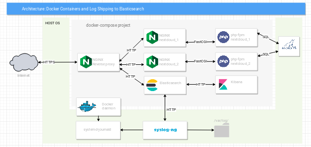
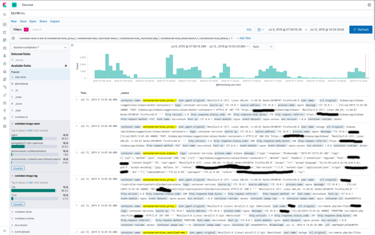

A simplified guide to logging Docker to Elasticsearch. Although there are many tutorials about how to ship Containers logs to Elasticsearch, this one is different from all as it uses [syslog-ng](https://www.syslog-ng.com/products/open-source-log-management/). It also works with Podman!

**Update:** I moved the chapters about parsing and [visualizing NGINX / Apache access logs in Kibana](/2019/02/09/visualizing-nginx-access-logs-kibana/) into a dedicated post / github repo.

**Update 2: **This post has been refactored and simplified to be compatible with [Elasticsearch ECS](https://www.elastic.co/guide/en/ecs/current/ecs-reference.html) and make it easier to implement. Compatible with Elasticsearch 7.x.

**Update 3 (2020):** Add support both for Docker and Podman. Improved readability. 

## Choosing the right logging driver

The formats of the logs could be different container by container. Fortunately both Docker daemon and Podman provides multiple drivers to collect and forward the logs to other systems regardless of the format of the logs. **This solution uses journald.** Using Journald is widespread among the most popular container hosts. And logs are already enriched by container metadata we can use later on.

## Overview of a single host setup

The following chart gives you an overview about a single host system serving [Nextcloud](https://nextcloud.com/athome/) sites. From our perspective it is just PHP services and HTTP servers which are reachable from the Internet through a reverse proxy. For smaller projects it is much easier than using Kubernetes or its derivatives.

[](/assets/uploads/2019/02/docker-elastic-logging-architecture-1250.png)Every container logs are sent to journald.
Syslog-ng reads the journals and sends the processed messages to Elasticsearch, which in fact runs in the same Docker environment.

The logging daemon stores the logs both on local filesystem and in Elasticsearch. Therefore in case Elastic goes down, no logs will be lost. 

### Configuring Docker daemon to store logs of containers in journald

In my example I use this [docker-compose.yml](https://github.com/abalage/balagetech-logging-docker-to-elasticsearch/blob/master/docker-compose.yml) file for Nextcloud. You can swap Nextcloud to any service you may already have in your containers. The basics are the same.

#### Explaining logging related options

To logging Docker to Elasticsearch first we need to use **journald** driver to collect the logs of the containers. The following Compose config exactly does that.

```
services:
    proxy:
        logging:
            driver: journald
            options:
                labels: "application"
                tag: "nginx|{{.ImageName}}|{{.DaemonName}}"
        labels:
            application: "reverse_proxy"
```

The **logging→options→labels:application** key value pair maps to **labels→application**. Effectively it adds the "application:reverse\_proxy" label to the container called "proxy".

Defining the tag **logging→****options→tag:"nginx|{{.ImageName}}|{{.DaemonName}}"** is very important. Syslog-ng will parse this field to extract **process.name**, **container.image.name** and **container.image.tag** filed according to [ECS](https://www.elastic.co/guide/en/ecs/current/ecs-process.html).

See the effect without "tag" being specified:

```
Nov 02 11:39:29 microchuck dockerd[1982]: 1.2.3.4 - - [02/Nov/2018:11:39:29 +0100] "GET / HTTP/1.1" 200 612 "-" "Mozilla/5.0 (Windows NT 6.1; WOW64) AppleWebKit/537.36 (KHTML, like Gecko) Chrome/51.0.2704.103 Safari/537.36" "-"
Nov 02 11:52:23 microchuck dockerd[1982]: 1.2.3.4 - - [02/Nov/2018:11:52:23 +0100] "GET / HTTP/1.1" 200 612 "-" "Mozilla/5.0 (Macintosh; Intel Mac OS X 10_11_6) AppleWebKit/601.7.7 (KHTML, like Gecko) Version/9.1.2 Safari/601.7.7" "-" 
```

And with "tag" specified.

```
Feb 04 00:20:39 microchuck nginx|nginx:1.16|docker[26858]: 1.2.3.4 - - [04/Feb/2019:00:20:39 +0100] "GET /.well-known/security.txt HTTP/1.1" 404 169 "-" "-" "-"
Feb 04 00:20:52 microchuck nginx|nginx:1.16|docker[26858]: 1.2.3.4 - - [04/Feb/2019:00:20:52 +0100] "GET /favicon.ico HTTP/1.1" 404 169 "-" "python-requests/2.10.0" "-" 
```

### Configuring Podman to store logs of containers in journald

Although there are no YAML files to store the settings. The setup is pretty similar to Docker's.

```
podman run -d --name proxy --expose 80 --expose 443 \
  -v ${config}/nginx/proxy/conf.d/:/etc/nginx/conf.d/ \
  -v ${config}/nginx/proxy/ssl.conf:/etc/nginx/ssl.conf:ro \
  -v ${config}/nginx/ssl:/etc/nginx/ssl:ro \
  --log-driver journald \
  --log-opt tag="nginx|{{.ImageName}}|podman" \
  --log-opt labels=process \
  --label=process=nginx \
  nginx:1.18
```

## Managing container log messages by syslog-ng

All referenced materials can be found in this git repository: [abalage/balagetech-logging-docker-to-elasticsearch](https://github.com/abalage/balagetech-logging-docker-to-elasticsearch)

Both Docker Compose and Podman sets some container metadata like **label** and **tag**. As well as container name and ID. The next step is to read container's logs from journald and parse these metadata.

Syslog-ng already collects and stores messages of containers on local filesystem. Both in volatile journals and persistent json files.

Before you activate the configuration you have to make sure you adjust the variable **elastic\_host**, **elastic\_user** and **elastic\_pass** to reflect your environment.** **

Also make sure [the index template](https://github.com/abalage/balagetech-logging-docker-to-elasticsearch/blob/master/elastic/containers-index-template.txt) is [loaded into Elasticsearch](/visualizing-fail2ban-logs-in-kibana/#Create_index_patterns_in_Kibana) and the elastic\_user has the necessary rights to write and manage indexes "**containers-\***".

Now you are ready to reload syslog-ng for the changes to take effect.

**Hint:** You can see more example about using syslog-ng by [setting up a network source to collect OpenWRT logs](/creating-a-central-syslog-server/#Adding_OpenWRT_logs_via_network_sources) or [getting GeoIP metadata sent into Elasticsearch](/visualizing-fail2ban-logs-in-kibana/#Send_Fail2ban_logs_into_Elasticsearch).

## Discovering container logs in Kibana

If you successfully adopted the referenced guide about creating the index pattern in Kibana you can browse the logs in **Discover** menu.

Notice that ECS fields for [containers](https://www.elastic.co/guide/en/ecs/current/ecs-container.html) and [hosts](https://www.elastic.co/guide/en/ecs/current/ecs-host.html) are already set. The following screenshot shows an older example.

[](/assets/uploads/2019/07/docker-kibana-discovery-1250_2.png) 

### Creating Docker visualizations in Kibana

There are many visualizations like **Data Table**,** Vertical Bar**,** Pie Chart **and** Line**. I created short videos about how you can make use of them.

#### Creating a stacked Vertical Bar visualization

This chart is useful to show how the amount of logs per app changes in time. You can use this type of visualization for other attributes too.

<iframe width="560" height="315" src="https://www.youtube.com/embed/mice-ldMUOQ" title="YouTube video player" frameborder="0" allow="accelerometer; autoplay; clipboard-write; encrypted-media; gyroscope; picture-in-picture" allowfullscreen></iframe>

#### Creating a **Line** visualization for getting log trends

I use this type of visualization for seeing the trends how the number of logs changes in time. You can put **Data Table **next to it in a Dashboard to show more insights.

<iframe width="560" height="315" src="https://www.youtube.com/embed/ACW8ve7hYcM" title="YouTube video player" frameborder="0" allow="accelerometer; autoplay; clipboard-write; encrypted-media; gyroscope; picture-in-picture" allowfullscreen></iframe>

#### Creating a **Data Table** visualization to the amount of logs per container

The **Data Table** visualization usually more readable than **Vertical Bars**. For instance when texts on X-Axis are too long I prefer the Data Table.
The video below was made for HTTP Agents. Just replace the Field of Aggregation to "container.name".

<iframe width="560" height="315" src="https://www.youtube.com/embed/IfKPcRIUSzc" title="YouTube video player" frameborder="0" allow="accelerometer; autoplay; clipboard-write; encrypted-media; gyroscope; picture-in-picture" allowfullscreen></iframe>

#### Creating a **Pie Chart** visualization to show the amount of logs per app

**Pie Charts** are pretty good for counting the amount of data when your data set has limited variability. For example there are only a dozen of app names and not hundreds.
The video below was made for HTTP Response codes. You should be able to adjust the Field of Aggregation to "process.name".

<iframe width="560" height="315" src="https://www.youtube.com/embed/lT0Hz61Tjg4" title="YouTube video player" frameborder="0" allow="accelerometer; autoplay; clipboard-write; encrypted-media; gyroscope; picture-in-picture" allowfullscreen></iframe>

### Creating dashboard from visualizations in Kibana

You should add the recently created visualizations to a Dashboard.
Check the video below to see how you can do that.
Although the video presents [NGINX logs](/2019/02/09/visualizing-nginx-access-logs-kibana/), the method is the same for Docker logs.

<iframe width="560" height="315" src="https://www.youtube.com/embed/apjwt1UK0xA" title="YouTube video player" frameborder="0" allow="accelerometer; autoplay; clipboard-write; encrypted-media; gyroscope; picture-in-picture" allowfullscreen></iframe>

## Final words

I really liked this project. I could learn many new things and the results are simply amazing. My plan is to use this system and improve it on the go.

Configurations for syslog-ng and docker-compose. The visualizations and dashboard for Kibana. As I promised you can download them all [from this GitHub repository](https://github.com/abalage/balagetech-logging-docker-to-elasticsearch). Feel free to use them.

**Update:** I moved the chapters about parsing and [visualizing NGINX / Apache access logs in Kibana](/2019/02/09/visualizing-nginx-access-logs-kibana/) into a dedicated post. Please make sure you check it out.

If this post was helpful for you, then please share it. Most importantly, should you have anything to add then please make any comments below. I will appreciate it.

Thank you.
