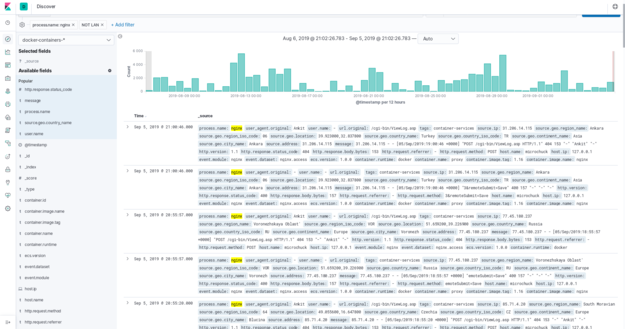
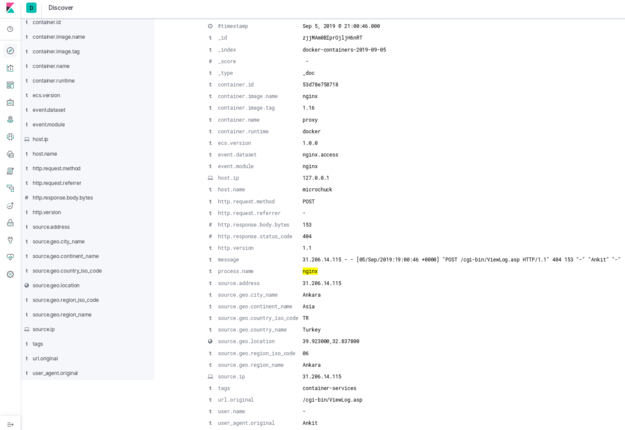

Visualizing NGINX access logs in Kibana is one of my most visited post in my blog. It is time for a major update. This guide can easily be added into a [central log server](/2019/01/14/creating-a-central-syslog-server/) where someone already [collects logs of Docker containers](/2019/02/06/simplified-logging-docker-elasticsearch-syslog-ng/). Especially because it is quite common to run web servers in containerized systems. This tutorial shows you how to parse access logs of NGINX or Apache with syslog-ng and create [ECS](https://www.elastic.co/guide/en/ecs/current/ecs-reference.html) compatible data in Elasticsearch. I also describe how visualizing NGINX access logs in Kibana can be done.

## **Parse NGINX/Apache access logs to provide insights about HTTP usage**

There is a specific parser in syslog-ng called [apache-accesslog-parser](https://www.syslog-ng.com/technical-documents/doc/syslog-ng-open-source-edition/3.16/administration-guide/65#TOPIC-956636) which can further parse access logs of NGINX or Apache web servers. It works on logs complying either to [Common Log Format (Apache default)](http://httpd.apache.org/docs/2.4/mod/mod_log_config.html) or to [Combined Log Format (NGINX default)](http://nginx.org/en/docs/http/ngx_http_log_module.html).

Using it will provide you more insights about HTTP usage. There is only one problem with it. Although it provides Logstash compatible field names, but they are not updated to comply with [Elastic Common Schema (ECS)](https://www.elastic.co/guide/en/ecs/current/ecs-reference.html) which is the new standard since Elasticsearch version 7.0.

The [configuration](https://github.com/abalage/balagetech-nginx-apache-syslog-ng-elasticsearch/blob/master/syslog-ng/conf.d/nginx.conf) sample I provide gives you ECS support, so you can even use the official Dashboards. Because of the length of the configuration I uploaded it to GitHub and not added here. Use it with the either the guide I wrote in [logging Docker to Elasticsearch](/2019/02/06/simplified-logging-docker-elasticsearch-syslog-ng/) or add it to any standalone web servers. The choice is yours.

The only thing which needs to be changed in the [configuration](https://github.com/abalage/balagetech-nginx-apache-syslog-ng-elasticsearch/blob/master/syslog-ng/conf.d/nginx.conf) is a global variable called **elastic\_host** which should point to your Elasticsearch Ingest node.

The other big thing this config gives you is to enrich the logs with GeoIP metadata of HTTP clients. Again, Logstash or even an Elasticsearch ingest node would do this for you, but I use syslog-ng instead of Logstash or ingest pipelines.

The configuration I provided earlier will do GeoIP resolving for you. Just do not forget to install the [GeoIP updater script](https://github.com/abalage/balagetech-fail2ban-elasticsearch/blob/master/script/syslog-ng-update-free-geoip-db.sh) I wrote for [Visualizing Fail2ban logs in Kibana](/visualizing-fail2ban-logs-in-kibana/#Setup_collecting_and_parsing_logs_of_Fail2ban) to periodically update the GeoIP databases.

**Please do not reload syslog-ng yet. **We need to create an index and an explicit data type mapping for some attributes before Elasticsearch will accept logs.** ** 

## Creating index and data type mapping in Elasticsearch

Most of the data which are put into the indexes are mapped as [keyword](https://www.elastic.co/guide/en/elasticsearch/reference/6.5/keyword.html). This is good in most cases. For visualizing NGINX access logs in Kibana we need explicit data type mapping for some records. The mapping is compatible with [ECS](https://www.elastic.co/guide/en/ecs/current/ecs-reference.html).

To create the mapping either follow the steps I described in [setting data type mappings for Fail2ban](/visualizing-fail2ban-logs-in-kibana/#Create_index_template_for_Fail2ban_in_Elasticsearch). Or go to **Dev Tools→Console** in Kibana and paste - again because of its length - [the API command you can download here](https://github.com/abalage/balagetech-nginx-apache-syslog-ng-elasticsearch/blob/master/elasticsearch/nginx-index-mapping.txt).

Now it is time to reload syslog-ng. After a couple of logs reached Elastic, make sure you [create index patterns](/visualizing-fail2ban-logs-in-kibana/#Create_index_patterns_in_Kibana) for the rest of the data, not described in the explicit mapping before. Please note that index template will create indexes matching **nginx-\***. You may want to follow that with index patterns. Although you may want to reconsider this as the [official Filebeat Dashboards for NGINX](https://github.com/elastic/beats/tree/master/filebeat/module/nginx/_meta/kibana/7/dashboard) would expect **filebeat-\*** instead.

## Discovering access logs in Kibana

If you succeeded to follow the steps, you will have an index pattern called **nginx-\***. Try to browse the log messages in **Kibana→Discover** menu.

The following screenshot have been updated to Elasticsearch 7.2 and show all fields complying to ECS.

Scroll down a bit and you shall see the added GeoIP and http (NGINX) metadata as well.

This is already useful but we are going to create interesting visualizations in the next chapter.

### Creating NGINX and Docker visualizations in Kibana

Visualizing NGINX access logs in Kibana can be done by using visualizations like **Data Table**,** Vertical Bar**,** Pie Chart **and** Coordinate Map**. I created short videos about how you can make use of them.

#### Creating a **Vertical Bar** visualization for NGINX average bytes

This chart is useful to show the size of traffic changes in time. You can use this type of visualization for HTTP Response codes. A **Pie Chart** also works nicely with that.

It can also present you the amount of logs each container produces.

<iframe width="560" height="315" src="https://www.youtube.com/embed/hJKx0nhRNaw" title="YouTube video player" frameborder="0" allow="accelerometer; autoplay; clipboard-write; encrypted-media; gyroscope; picture-in-picture" allowfullscreen></iframe>

#### Creating a **Coordinate Map** visualization for GeoIP data of HTTP clients

I used this type of visualization for Fail2ban logs before. You can use it to see where your HTTP clients are coming from. The free GeoIP database is enough to narrow down to counties or bigger areas.

<iframe width="560" height="315" src="https://www.youtube.com/embed/430TwfwnV3E" title="YouTube video player" frameborder="0" allow="accelerometer; autoplay; clipboard-write; encrypted-media; gyroscope; picture-in-picture" allowfullscreen></iframe>

#### Creating a **Data Table** visualization to show TOP 10 HTTP User Agents

The **Data Table** visualization usually more readable than **Vertical Bars**. For instance when texts on X-Axis are too long I prefer the Data Table.

<iframe width="560" height="315" src="https://www.youtube.com/embed/IfKPcRIUSzc" title="YouTube video player" frameborder="0" allow="accelerometer; autoplay; clipboard-write; encrypted-media; gyroscope; picture-in-picture" allowfullscreen></iframe>

#### Creating a **Pie Chart** visualization to show TOP 10 HTTP Response codes

**Pie Charts** are pretty good for counting the amount of data when your data set has limited variability. For example there are only a dozen of container names and not hundreds.

<iframe width="560" height="315" src="https://www.youtube.com/embed/lT0Hz61Tjg4" title="YouTube video player" frameborder="0" allow="accelerometer; autoplay; clipboard-write; encrypted-media; gyroscope; picture-in-picture" allowfullscreen></iframe>

### Creating dashboard from visualizations in Kibana

Visualizing NGINX access logs in Kibana is not ready yet. You should create a new Dashboard and add the recently created visualizations to it. It will look really nice.
Check the video below to see how you can do that.

<iframe width="560" height="315" src="https://www.youtube.com/embed/apjwt1UK0xA" title="YouTube video player" frameborder="0" allow="accelerometer; autoplay; clipboard-write; encrypted-media; gyroscope; picture-in-picture" allowfullscreen></iframe>

## P.S.

Originally this content was embedded in the [Simplified guide to logging Docker to Elasticsearch in 2019 (With syslog-ng)](/2019/02/06/simplified-logging-docker-elasticsearch-syslog-ng/). However I realized that it makes sense to have dedicated tutorials for each subject.

Configurations for syslog-ng, the index template and mapping for Elasticsearch. They all can downloaded [from this GitHub repository](https://github.com/abalage/balagetech-nginx-apache-syslog-ng-elasticsearch).

Again, should you have any comments then feel free to make any below. I will also highly appreciate if you share this post.

Thank you!
