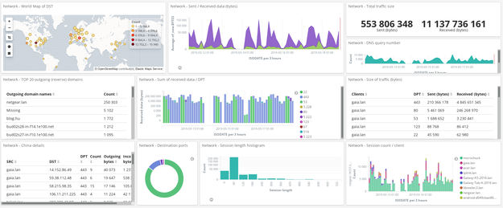
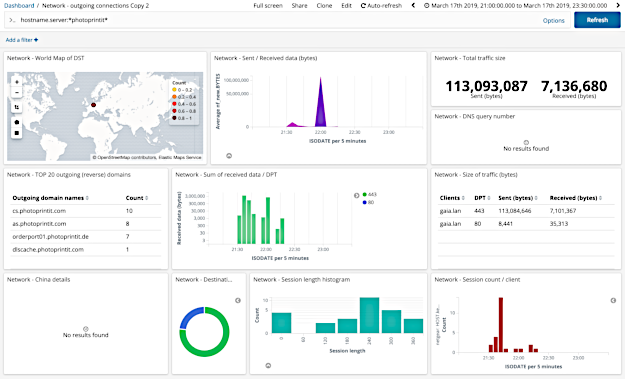
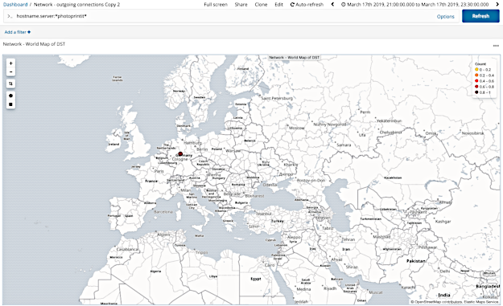
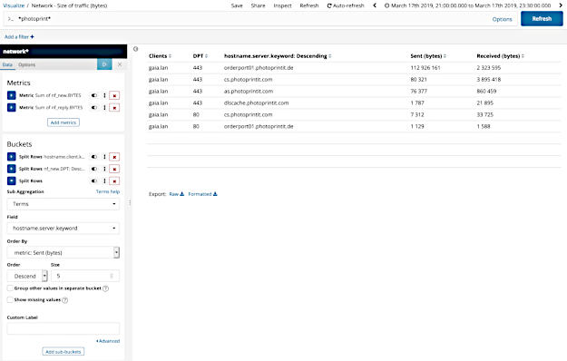
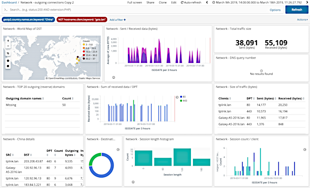
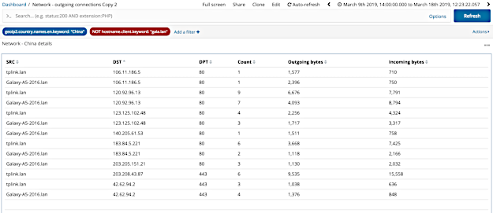

Monitor home network traffic with OpenWRT and Syslog-ng with Elasticsearch Security. I wanted to see what happens on my home network. Is there something going on I should be aware of? Is there any device which creates suspicious connections like phoning home? I will use OpenWRT and syslog-ng to get the answers and Elasticsearch Security to get the analytics.[](/assets/uploads/2019/03/kibana-dashboard-outgoing-connections-2-1250.png)

## **Important updates: 12/02/2023**

This post seems like getting some of attention from various people recently and I am very happy about it. I understand the need of reproducible configurations both for Syslog-NG and Elasticsearch, I would expect it too. I tried to address most of the problems mentioned in the comment section. The following changes occurred.

1. syslog-ng's configuration has been refactored and updated to match up version 4.5.0, also many hard wired settings are now populated via environment variables.

1. A Dockerfile is provided to help people who requires container images. This image is only meant for transforming <span style="text-decoration: underline;">fail2ban</span>, <span style="text-decoration: underline;">dnsmasq</span>, <span style="text-decoration: underline;">unbound</span> and <span style="text-decoration: underline;">ulogd2</span> logs to Elasticsearch. **Although you can send any kind of logs to TCP 6514 (IETF syslog) or TCP 514 (BSD syslog) of the container, do not expect them to be properly indexed by Elasticsearch.**

1. **<span style="color: #ff0000;">Be aware.</span>** The Dockerfile initializes a copy of **GeoLite2-City.mmdb** from a 3rd party site. It is only for testing, implement your own [method to fetch maps complying to the license requirements](https://dev.maxmind.com/geoip/updating-databases).

1. The legacy index template "network" has been converted to composable template. Tested it with Elasticsearch 8.7.1

1. Elasticsearch was installed by using this [elkninja/elastic-stack-docker-part-one/docker-compose.yaml](https://github.com/elkninja/elastic-stack-docker-part-one/tree/main).

Regarding Elasticsearch I have changed my mind. It is simply an overkill for most people who monitors home network traffic with OpenWRT and Syslog-ng. Even I myself have abandoned it 2 years ago. Although I updated Elasticsearch configurations but they are not thoroughly tested and I am not even planning to test it in the future. I have plans to look for another more lightweight solutions for visualizations. And maybe run it next to [Home Assistant on Kubernetes](/2023/06/15/running-home-assistant-on-kubernetes/). :)

## About monitoring home network traffic with OpenWRT and Syslog-ng

SOHO routers are usually not really resourceful, neither is mine. Therefore I needed a solution using as little resource as possible but still capable to answers that questions. My solution uses connection tracking data from an OpenWRT router. Offload the information from OpenWRT to a [central syslog server](/2019/01/14/creating-a-central-syslog-server/). Enrich it with GeoIP and session length metadata by using syslog-ng. Then analyze the logs with Elasticsearch. Recently it has been also enchanced with DNS information thanks to either dnsmasq or unbound DNS servers.

The first part of this blog series answers where the packets come and go and some metrics. What are inside the packets is up to another posts.

## Logging connection tracking data with OpenWRT and syslog-ng

My original idea was [to log the SYN and ACK,FIN packets](https://en.wikipedia.org/wiki/Transmission_Control_Protocol#Connection_establishment) with Iptables [on the FORWARD chain](https://openwrt.org/docs/guide-user/firewall/netfilter_iptables/iptables_log_targets) and correlate them. However it did not work as I planned. Although the most important data are included in syslog messages like network source, destination, port numbers. However the logs cannot be easily correlated to each other to get session data because there is no common identifier in iptables logs which would be unique to any given connection. (Stream ID would be but it is encoded in TCP options.) Logging all packets would simply kill the performance so it is not worth it. I needed an alternative solution.

Founding an essay about [Flow-based network accounting in Linux](https://www.kernel.org/doc/ols/2005/ols2005v2-pages-273-278.pdf) did turn the tide. I realized that 'nf\_conntrack' in Linux kernel (netfilter) actually keeps track of every connections throughout their lifetime (even UDP which is stateless). I only needed a tool to get that data off the OpenWRT router possibly to syslog-ng. The essay mentioned many tools but [ulogd](https://www.netfilter.org/projects/ulogd/index.html) looked the most promising.

Ulogd is capable to log connection tracking data to local syslog. The following example shows a NEW and a DESTROY event of a specific connection logged by ulogd.

```
Mar 13 15:03:57 openwrt ulogd[21765]: [NEW] ORIG: SRC=172.18.0.227 DST=1.2.3.4 PROTO=TCP SPT=57534 DPT=443 PKTS=0 BYTES=0 , REPLY: SRC=1.2.3.4 DST=5.6.7.8 PROTO=TCP SPT=443 DPT=57534 PKTS=0 BYTES=0
Mar 13 15:09:00 openwrt ulogd[21765]: [DESTROY] ORIG: SRC=172.18.0.227 DST=1.2.3.4 PROTO=TCP SPT=57534 DPT=443 PKTS=9 BYTES=3371 , REPLY: SRC=1.2.3.4 DST=5.6.7.8 PROTO=TCP SPT=443 DPT=57534 PKTS=8 BYTES=1301
```

*Note: 1.2.3.4 represents a website, while 5.6.7.8 represents the public IP of my home network.*

### Configuring ulogd2 on OpenWRT to send conntrack events to syslog-ng

My OpenWRT systems already send their syslog to a remote [central syslog server](/creating-a-central-syslog-server/#Adding_OpenWRT_logs_via_network_sources). OpenWRT uses logread to send syslogs remotely. The remote server runs on syslog-ng. Therefore I only have to configure ulogd to send the connection tracking events to local syslog instead of a file.

Fortunately ulogd can send the events to many destinations. I found a post about [logging connection tracking events with ulogd](https://home.regit.org/2014/02/logging-connection-tracking-event-with-ulogd/) and it helped me to configure the service properly.  
On the following link you can find the [complete configuration of ulogd](https://github.com/abalage/balagetech-openwrt-syslog-ng-elasticsearch/blob/master/openwrt/etc/ulogd.conf) I created for OpenWRT 18.06 (works with 19.07 too). Nevertheless I describe the details below as well.

1. First you have to install ulogd and some of its modules. You can do this either in LuCI or in the command line.

```
root@openwrt:~# opkg update \
&& opkg install ulogd ulogd-mod-nfct ulogd-mod-syslog ulogd-mod-extra
```

1. The configuration of ulogd uses an [INI style syntax](https://en.wikipedia.org/wiki/INI_file). Two sections will be important for us, \[global\] and \[ct1\].  
In \[global\] section after the list of plugins there will be presets of stacks. Stacks are a list of plugins and they work like commands piped together. There are input plugins, filter plugins and output plugins.

1. Look for the comment below. We are going to adjust the stack belonging to that comment like this.

```
# this is a stack for flow-based logging via LOGEMU
stack=ct1:NFCT,ip2str1:IP2STR,print1:PRINTFLOW,sys1:SYSLOG
```

1. Look for the section called \[ct1\]. We are adding a new configuration element called *hash\_enable*. Disabling hashes makes ulogd to log both NEW and DESTROY events separately. Otherwise it would only log DESTROY events. Although DESTROY contains everything we need the NEW events as well because of their timestamps, because we will make use of them for building session metadata.

```
[ct1]
hash_enable=0
```

1. You can do a manual check of the configuration by starting ulogd manually.

```
root@openwrt:~# ulogd -v
Mon Mar 11 15:42:51 2019 <5> ulogd.c:843 building new pluginstance stack: 'ct1:NFCT,ip2str1:IP2STR,print1:PRINTFLOW,sys1:SYSLOG'
Mon Mar 11 15:42:51 2019 <5> ulogd_inpflow_NFCT.c:1399 NFCT plugin working in event mode
```

1. The last step is to enable the service and start it.

```
root@openwrt:~# /etc/init.d/ulogd enable
root@openwrt:~# /etc/init.d/ulogd start
```

That is all you have to do to make OpenWRT send its connection tracking events to syslog-ng.

**Update:** Note for general Linux users. I found that netfilter accounting is usually disabled in kernels, especially on OpenSUSE Leap. This will result that PKTS and BYTES will always be 0. To overcome this one must enable accounting by executing the following command.

```
# runtime only
root@opensuse:~# echo "1"> /proc/sys/net/netfilter/nf_conntrack_acct
# make it permanent across system reboots
root@opensuse:~# echo 'net.netfilter.nf_conntrack_acct=1' > /etc/sysctl.d/100-custom.conf
```

Thanks to [Eric Leblond's great blog article](https://home.regit.org/2014/02/logging-connection-tracking-event-with-ulogd/) for mentioning it.

## Processing ulogd log messages from OpenWRT with syslog-ng

My goal is to parse and enrich ulogd messages with metadata like duration and GeoIP. Syslog-ng provides many parsers to use out of the box. You can see a short overview about the parsers I use in this case.

| **Metadata we add to logs** | **Syslog-ng parsers providing the metadata** |
| --- | --- |
| separate upstream and downstream metrics | [csv-parser()](https://www.syslog-ng.com/technical-documents/doc/doc1094716) |
| parsing key-value pairs from all streams | [kv-parser()](https://www.syslog-ng.com/technical-documents/doc/doc1094718) |
| creating session start, session end and length | [grouping-by()](https://www.syslog-ng.com/technical-documents/doc/syslog-ng-open-source-edition/3.19/administration-guide/79#TOPIC-1094769) |
| GeoIP metadata | [geoip2()](https://www.syslog-ng.com/technical-documents/doc/syslog-ng-open-source-edition/3.19/administration-guide/81#TOPIC-1094778) |
| Enrich DNS data from PublicSuffixList | [python()](https://www.syslog-ng.com/technical-documents/doc/doc1094731) |

Some parsers can be chained together in a single **parser{}** block. They behave like commands piped together in a Linux shell. One parser's output will feed the input of the next parser. Thus their order is important.

As the configuration is rather long and complex I uploaded [the complete syslog-ng configuration file to GitHub](https://github.com/abalage/balagetech-openwrt-syslog-ng-elasticsearch/blob/master/syslog-ng/etc/syslog-ng/conf.d/network-ulogd2.conf).

### Correlating log messages from OpenWRT with syslog-ng

The central syslog server receives two type of log messages from each connection. One message from NEW events and another from DESTROY events. These two symbolize the beginning and the end of a session. I will use **grouping-by()** parser to correlate these messages into one context and get the session length metadata. The admin guide has a flow chart about how messages are added to the context and how it gets terminated. You may want to read that in advance.

The parser uses **key()** and **scope()** to build-up a context and identify which messages needs to be added to the context.

For specifying **key()** requires already parsed data. My setup can be translated to this: **"Messages containing the same SRC, DST, SPT and DPT values from the ORIG part of the message belong to the same connection, unless they are not from the same host.**"

```
parser p_correlate_session_data {
  grouping-by(
    key("${source.ip}/${destination.ip}/${source.port}/${destination.port}")
    scope("host")
    where(match("ORIG" value("MESSAGE")))
    trigger(match("DESTROY" value("MESSAGE")))
    having( "${UNIXTIME}@2" ne "1" )
    aggregate(
      value("event.start" "${ISODATE}@2")
      value("event.end" "${ISODATE}@1")
      value("event.duration", "$(- ${UNIXTIME}@1 ${UNIXTIME}@2)")
      value("MESSAGE" "Session completed; client='${source.ip}'; server='${destination.ip}'; destination_port='${destination.port}; protocol='${network.transport}'; session_lenght='${event.duration}'\n")
      inherit-mode("context")
    )
    inject-mode("pass-through")
    # destroy events sometimes arrive later than 2 minutes, even when a client app is already closed (ssh, telnet)
    timeout(600)
  );
};
```

The context will be closed and evaluated either when a message arrives which matches the filter specified in **having()** or the **timeout()** occurs.  
*Important! The timeout is currently set to 10 minutes. Connections longer than 10 minutes will set to 10 minutes in Elasticsearch.  
*

The evaluation will aggregate the context and creates new name-value pairs specified with **values()**. For example, it creates a new MESSAGE. This message is logged the same place where the received logs are stored. Actually I only need the parsed name-value pairs for Elasticsearch. The existence of this message indicates that everything is available. Therefore I will filter on this message later.

## Configuring DNS data parsing with syslog-ng's Python parser

*Note: the original post mentioned reverse DNS data but the script I used did not have a permissive license so I decided to abandon it. The current solution does not use reverse DNS anymore.  
*

Elasticsearch relies on DNS data. It parses the DNS packets by packetbeat but that is too heavy for OpenWRT. Lucky for us almost everything can be parsed from query logs of DNS server software like dnsmasq or unbound.

OpenWRT uses dnsmasq by default. You can turn on query logging in "**DHCP and DNS → Server settings → General settings → Log queries**". That's all.

Please note that I rather use **unbound** because of its support for DNS over TLS (DoT). The syslog-ng config I have for dnsmasq is pretty outdated but it can be easily updated with the example of unbound. Pull requests are welcome. ;)

DNS logs should be parsed further to get domain, tld, subdomain and regdomain, all the fancy stuff Elasticsearch supports. This is done by a python parser. Specifying the python parsers should look like this.

```
parser p_unbound_csv {
    csv-parser(
        columns(question.ptid, syslog.level, source.ip, dns.question.name, dns.question.type, dns.question.class)
        delimiters(chars(' '))
        template("${MESSAGE}")
    );

    map-value-pairs(
        pair("event.action",                "dns-query")
        pair("destination.ip",              "172.18.0.10") # DNS server
        pair("event.category",              list("network"))
        pair("event.dataset",               "network.dns")
        pair("event.kind",                  "event")
        pair("event.module",                "network")
        pair("event.provider",              "unbound")
        pair("event.type",                  "info")
        pair("tags",                        list("syslog-ng"))
        pair("dns.type",                    "query")
        pair("network.direction",           "outgoing")
    );

    python(
        class("DNSSuffixResolver")
        options(
            "domain" "dns.question.name"
            "tld" "dns.question.top_level_domain"
            "subdomain" "dns.question.subdomain"
            "regdomain" "dns.question.registered_domain"
        )
    );
};
```

[Public Suffix List](https://publicsuffix.org/) is used to parse domain, tld, subdomain and regdomain from FQDNs. A python module with the same name is used by syslog-ng for the parsing. The database must be regurarly updated. Here is a simple cronjob to do that.

```
0 4 * * * curl https://raw.githubusercontent.com/publicsuffix/list/master/public_suffix_list.dat -o /usr/lib/python3.6/site-packages/publicsuffixlist/public_suffix_list.dat &>/dev/null
```

Both syslog-ng configuration and the parsers code are uploaded to [GitHub](https://github.com/abalage/balagetech-openwrt-syslog-ng-elasticsearch).

## Configuring GeoIP enrichment for syslog-ng

Syslog-ng so as Elasticsearch relies on Maxmind's GeoIP databases. You should register yourself to be able to periodically download the databases. I provided an example config. The most important parts are that the downloaded databases should be placed in /etc/syslog-ng. This way you do not have to adjust Apparmor settings.

## Configuring Elasticsearch to ingest logs from OpenWRT

Sending network traffic data of your home network from OpenWRT to syslog-ng is a great thing. But what is more cooler is to send it to Elasticsearch and create visualizations and reports. You can create nice visualizations once you have proper index template including [ECS compatible](https://www.elastic.co/guide/en/ecs/current/ecs-field-reference.html) data type mapping. <span style="text-decoration: underline;">I emphasize that without this step Elasticsearch Security will not work at all.</span>

### Creating an index template for network events

Explicit mapping should be created manually by using Elasticsearch's PUT API. You can do this in **Dev Tools → Console**. If this is new to you, then you should check [my previous step by step guide](https://balagetech.com/visualizing-fail2ban-logs-in-kibana/#Create_index_template_for_Fail2ban_in_Elasticsearch) about it.  
Because of the length of the mapping file I provide a downloadable version of the index template [in the following file on GitHub](https://github.com/abalage/balagetech-openwrt-syslog-ng-elasticsearch/blob/master/elasticsearch/template-network.json).

Please note that this mapping also specifies a template for the index names it will match on. In my case it is **network-\***.

## Monitoring my home network with examples

I already created [videos about how you can make different type of visualizations in Kibana](https://balagetech.com/simplified-logging-docker-elasticsearch-syslog-ng/#Creating_Docker_visualizations_in_Kibana). You should definitely check the videos if you are stuck. Therefore this time I picked up two recent cases because I wanted to focus on what benefits I could get by having network data in Elastic.

### Where and how are my images uploaded by using a web printing service?

**Update:** The examples below used an older implementation and the attribute names are different from ECS mappings. However you can still get the idea.

I wanted to print dozens of family photos on paper. I decided to use CEWE's service to do that. They even have a [Qt based software](https://en.wikipedia.org/wiki/Qt_(software)) for Linux to place orders.

I wanted to feel secure as I am about to upload private data to someone else's computer. Where are they uploaded? Are those services use HTTPS for transferring my precious family photos? Let's find that out.

**Note: My actions did take place between 21:00 and 22:30 on March 17th, 2019.**

- In the browser's address bar I noticed that registration and uploading takes place on "photoprintit" domains via HTTPS. Let's check the traffic belonging to those domains. Using the following regex query **outbound.destination.address:\*photoprint\*** [on the dashboard](https://www.youtube.com/watch?v=apjwt1UK0xA) gave me the following results.[](/assets/uploads/2019/03/kibana-photoprintit-1250.png)

- On the top left corner in [Coordinate Map visualization](https://www.youtube.com/watch?v=430TwfwnV3E) we can see that all traffic goes to Germany (I am located in Hungary). As a result I checked the service's [Data Privacy document](http://www.foto-rossmann.hu/adatvedelem.html) which also shows that both their web site and the hosting is located in Germany. [](/assets/uploads/2019/03/kibana-photoprintit-geomap-1250.png)The service provider is a German company, however it is quite funny that I had to send my photos to Germany for printing so they will deliver them back to Hungary.

- Do they use HTTPS for the traffic? Let's use a [Data Table visualization](https://www.youtube.com/watch?v=IfKPcRIUSzc) to see that. It seems like that there are some traffic on 80, however most of the traffic goes to 443 (HTTPS).[](/assets/uploads/2019/03/kibana-photoprintit-datatable-1250.png)

I did not have to do any extra work to get these information because GeoIP, ~~Reverse~~ DNS, traffic size and details are all there. As a result I could do the same exercise with any other web site.

### Is there any device on my network phoning home?

Is there any network traffic going to a specified country, for instance[is there anything going to China unattended](/2019/04/27/android-app-phones-home-china/)? (I could choose any other country.)

**Note: In the following examples I excluded a client host where I made explicit connections to Chinese websites. Data is from 11 day long period.**

- We can filter on a country by using **outbound.destination.geo.country\_name:China**.[](/assets/uploads/2019/03/kibana-china-dashboard-1250.png)

- According to the results there are two devices which communicate to that country. The device **tplink.lan** is a WiFi Access Point running on OpenWRT. The other device ****[Galaxy-A5-2016.lan](https://balagetech.com/android-app-phones-home-china/#Case_1_Samsung_Galaxy_A5_2016) is a smartphone connecting to that access point over WiFi.  
Let' see the details on a different [Data Table visualization](https://www.youtube.com/watch?v=IfKPcRIUSzc) again.[](/assets/uploads/2019/03/kibana-china-datatable-1250.png)

Apparently there are communication going outwards of my home network, however I still do not know what is inside of them. That WiFi Access Point used [NAT](https://en.wikipedia.org/wiki/Network_address_translation) a couple of days ago until I disabled it, seems like there may be duplicate entries.

A logical next step would be to run tcpdump on OpenWRT parameterized to only capture and save TCP packets going on to those IP addresses. You can further analyze the packet captures  with other tools. But this is a topic of another post I will write later.

## Verdict

I hope that with the help of this blog post anyone can monitor their home network with OpenWRT and syslog-ng and Elasticsearch.

If this post was helpful for you, then please share it. Even more should you have anything to ask then feel free to make any comments below. I will highly appreciate it.
