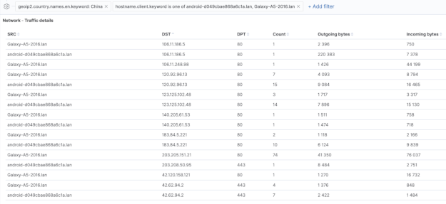
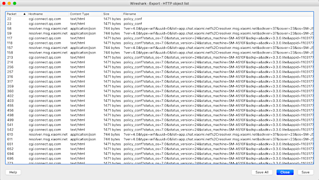

In my previous blog post I created a system to [monitor my network traffic](/2019/03/20/monitor-network-traffic-openwrt-syslog-ng/). This system is capable to visualize connections [even in geographic manner](/2019/02/09/visualizing-nginx-access-logs-kibana/). Checking the data I found two network devices who phones home to servers located in China. What can I find out about those connections. What are they? Do they pose any security threat to me?

My sole purpose was to experiment and learn new things. Please mind that I could pick any other countries the same way as I chose China. Although I have security concerns, **I want to learn and not to make statements over any countries or vendors**.

## Finding out who phones home to China

The starting point for my experiments is getting network details from my [network monitoring system](/2019/03/20/monitor-network-traffic-openwrt-syslog-ng/) to get some insights about traffic.

- I have a list of IP addresses of servers which are located in China. So as the number of occasions and size of transferred data of the connections.

- All traffic took place over plain HTTP which are not encrypted. Even the one which addressed port TCP 443.

- Traffic were initiated by two different Android phones in our household. (I also made some traffic to China from another host during troubleshooting, therefore I excluded that host from the report.)

[](/assets/uploads/2019/04/china-details-data-table-1250.png)

The biggest pain point here is for performance and capacity reasons my setup did not collect network packets themselves but only metadata.
At this point I was only aware of the connections but did not have visibility about their actual content.

## Creating packet captures from network traffic

Packet captures should take place [on the router device](https://balagetech.com/creating-a-central-syslog-server/#Adding_OpenWRT_logs_via_network_sources). I was expecting if there is something what phones home to China, it may try again. Therefore I executed a tcpdump command to save any future traffic matching any IP address from the list I specified.
For your reference, I used this command to capture packets.

```
tcpdump -peni any -s 0 -w /path/to/storage/capture.pcap tcp \
(host 203.205.151.2 or host 120.92.96.13 or host 123.125.102.48 \ 
or host 183.84.5.221 or host 42.62.94.2 or host 140.205.61.53 \ 
or host 42.120.158.121 or host 106.11.186.5 or host 106.11.248.98)
```

After more than a week I had enough traffic captured to analyze it with Wireshark. Albeit I noticed that not all IP address from the list had packets in the pcap.

If you are interested in, I mounted a remote server's storage via sshfs on OpenWRT to circumvent the small storage the router has.

## Analyzing packet captures with Wireshark

As it turned out all connection were plain HTTP. As a first step I made [Wireshark](https://www.wireshark.org/) to save all HTTP objects from the capture file. Simply following **"File → Export objects → HTTP..."** already reveals a lot of details.

[](/assets/uploads/2019/04/wireshark-saved-http-objects-1250.png)HTTP requests and responses contain a lot of things, like URI of the HTTP request, the server name. The parameters of GET and PUT requests can also reveal the actual traffic. While User Agent can give hints about the application which initiated the connection. And so on.

Let's see what information we can get from the HTTP headers and responses.

It looks like whoever is trying to phoning home to China is probably addressing QQ or Xiaomi servers.

### Case 1: Samsung Galaxy A5 2016

This phone is a Samsung Galaxy phone and it has a private IP address of 172.18.0.102.
This devices constantly made requests to destination 203.205.151.21.

#### IP: 203.205.151.21

Here are the HTTP request and response headers.

```
GET /qqconnectopen/openapi/policy_conf?status_os=7.0&status_version=24&status_machine=SM-A510F&sdkp=a&sdkv=3.3.0.lite&appid=1103177325 HTTP/1.1
Accept-Encoding: gzip
Host: cgi.connect.qq.com
Connection: Keep-Alive
User-Agent: AndroidSDK_24_a5xelte_7.0 
```

- The web server host is "cgi.connect.qq.com". The domain qq.com belongs to [Tencent QQ](https://en.wikipedia.org/wiki/Tencent_QQ) which is a Chinese instant messaging app vendor.

- The web server software is "tws"

- The GET request URI sends OS version information and phone brand and type to the requested site. The string qqconnectopen I think is actually referring to [Tencent's Open Platform](http://open.qq.com/eng/).

- By the way from the User-Agent, they can also decode the brand and type of the phone, so as the major version of Android it runs.

Wireshark decoded the gzipped response as well. It is actually a JSON response. I only did a pretty print for better readability.

```
HTTP/1.1 200 OK
Date: Tue, 02 Apr 2019 05:27:13 GMT
Content-Type: text/html; charset=utf-8
Transfer-Encoding: chunked
Connection: keep-alive
Server: tws
Vary: Accept-Encoding
Content-Encoding: gzip

{
   "Common_SSO_QZoneSchema" : "mqzone",
   "Common_DownloadReportMaxcount" : 3,
   "Common_tips_dialog_interval" : 2000,
   "Common_DownloadReportTimeinterval" : 36000,
   "Common_CGIReportTimeinterval" : 1200,
   "Agent_ReportTimeInterval" : 5000,
   "Common_WebReportFrequency" : 1,
   "Common_QQ_VERSION" : 10000,
   "Common_Release_Control" : "-1",
   "Common_SSO_QzoneVersion" : "3.6.8",
   "Common_root_autoinstall_flag" : 1,
   "Common_ApkUpdateConfig" : 1,
   "Common_frequency" : 1,
   "Common_Appstore_FullUpdateOnly" : 0,
   "Common_WNS_Theme_Switch" : 0,
   "Common_Max_Count" : -1,
   "Common_ta_enable" : 1,
   "Common_Dialog_Only_Once_Flag" : false,
   "Common_BusinessReportMaxcount" : 1,
   "Common_WNS_Channel_Switch" : 1,
   "Common_Show_Dialog_Flag" : true,
   "Common_CGIReportFrequencySuccess" : 10,
   "Common_DownloadReportFrequency" : 1,
   "Common_PushReportFrequency" : 1,
   "C_Full_Report" : true,
   "Agent_ReportBatchCount" : 5,
   "Common_Detail_Page" : true,
   "Common_CGIReportMaxcount" : 5,
   "Common_myapp_download_url" : "http://a.app.qq.com/o/myapp-down?g_f=991310",
   "C_LoginH5" : true,
   "Common_114DNS_Resolve_All" : false,
   "Common_HttpRetryCount" : 3,
   "Common_CGIReportFrequencyFailed" : 100,
   "Common_MyAppDownload_Flag" : true,
   "Common_114DNS_Resolve_Timeout" : 10,
   "C_LoginWeb" : false,
   "Common_BusinessReportTimeinterval" : 1,
   "Common_HttpConnectionTimeout" : 15000,
   "Common_BusinessReportFrequency" : 100,
   "Common_CGIReportFrequency" : 100,
   "Common_yyb_wifi_download_Switch" : true,
   "Common_SocketConnectionTimeout" : 30000,
   "Common_require_root_interval" : 86400000,
   "ret" : 0,
   "Common_114DNS_CGI_To_Resolve" : "",
   "Common_QQ_Patch_Switch" : true
}
```

-  

  - [QZone](https://en.wikipedia.org/wiki/Qzone) is a Chinese social network. I do not have anything like that installed.

  - The Common\_myapp\_download\_url points to an APK you can actually download. The APK names itself as com.tencent.android.qqdownloader (QQDownloader) which is the [Chinese counter part of Google Play](https://blog.trustlook.com/2015/11/12/analysis-of-repackaged-applications-from-over-one-thousand-qqdownloaders-in-global-android-marketplaces/). If you want to see more details about the APK then have a look at the [analysis done by VirusTotal](https://www.virustotal.com/#/file/ef0aef45106efce018c1ff76bf77e8fddb6ba96514e94b37f526a51d998f574a/details).
The most interesting parts are the Android permissions it requires. It is simply a 'superuser' app.

Recently because this phone had issues I decided to do a factory reset and root it. Since then there were no new connection which tried to phone home to China. <span style="text-decoration: underline;">Unfortunately I am able to further audit this kind of traffic.</span> 

### Case 2: Samsung Galaxy J5 2016

This is phone is also a Samsung Galaxy phone and it has a private IP address of 172.18.0.220. This devices constantly makes HTTP(S) requests to the following destinations:

- 42.62.94.2

- 120.92.96.13

- 123.125.102.48

- 183.84.5.221

#### IP: 42.62.94.2

The clients addressed TCP port 443. Although the TCP handshake was okay no HTTPS connections were established. Checking the PSH, ACK flags I can see the following TCP payload in ASCII dump. I do not think they run a HTTPS service on that port.

```
.......r.......T...
xiaomi.com*.CONNH..j.	SM-J510FN..J510FNXXS2AQI4".GkdbaFv1C3GJT-F3(%2.wifi:.42.62.94.2:443B.hu_HUJ...P..).@
```

Visible things are:

- xiaomi.com

- identifiers of the phone device, exact firmware and its locale

#### IP: 120.92.96.13, 123.125.102.48 and 183.84.5.221

There were daily logins to these IP addresses on plain HTTP. Let's check the HTTP requests and responses. They are the same for all IPs.

```
GET /gslb/?ver=4.0&type=wifi&uuid=0&list=app.chat.xiaomi.net%2Cresolver.msg.xiaomi.net&sdkver=37&osver=23&os=SM-J510FN%3AJ510FNXXS2AQI4&mi=0&key=6d8fafdcbfacf6c3eec939d746ac3370 HTTP/1.1
User-Agent: Dalvik/2.1.0 (Linux; U; Android 6.0.1; SM-J510FN Build/MMB29M)
Host: resolver.msg.xiaomi.net
Connection: Keep-Alive
Accept-Encoding: gzip
```

The response is again a JSON file. I only did a pretty print here for better readability.

```
HTTP/1.1 200 OK
Server: Tengine/2.2.2
Date: Tue, 02 Apr 2019 19:11:34 GMT
Content-Type: application/json; charset=utf-8
Content-Length: 744
Connection: keep-alive

{
   "R" : {
      "stat-domain" : "s.mi1.cc",
      "wifi" : {
         "app.chat.xiaomi.net" : [
            "47.74.170.155:5222",
            "47.74.170.157:5222",
            "47.74.170.158:5222",
            "47.74.170.157:80",
            "47.74.170.158:80",
            "47.74.170.155:80",
            "47.74.170.155:443",
            "47.74.170.157:443",
            "47.74.170.158:443"
         ],
         "resolver.msg.xiaomi.net" : [
            "161.117.97.14:80"
         ]
      },
      "wap" : {
         "resolver.msg.xiaomi.net" : [
            "161.117.97.14:80"
         ],
         "app.chat.xiaomi.net" : [
            "47.74.170.155:5222",
            "47.74.170.157:5222",
            "47.74.170.158:5222",
            "47.74.170.157:80",
            "47.74.170.158:80",
            "47.74.170.155:80",
            "47.74.170.155:443",
            "47.74.170.157:443",
            "47.74.170.158:443"
         ]
      },
      "city" : "",
      "ttl" : 3600,
      "ip" : "80.99.22.19",
      "X-Forwarded-Ip" : "80.99.22.19",
      "tid" : -1,
      "stat-percent" : 0.05,
      "force-use" : "false",
      "isp" : "",
      "country" : "",
      "extra-for-pa" : "debug info",
      "province" : ""
   },
   "S" : "Ok"
}
```

For me this looks like a configuration update, but also sends data to the servers.
The following data are collected from our phone device:

- Phone brand and type

- Android OS version and exact firmware version

- My IP address (and therefore my rough location)

There is one more thing. You can see they use an [Tengine](https://github.com/alibaba/tengine) as webserver which is a fork of NGINX. That is developed by Taobao which is owned by Alibaba. The domain mi1.cc is actually redirects to miliao.com which is a social network site of Xiaomi. As that phone also has MI Fit installed the traffic might been caused by that app. Although there is no clear evidence.

## Conclusions

Simply matching a network traffic to a process on and Android phone is almost impossible without host level information from the phone itself.

Looking through the installed apps on both phones I could only find [MI Fit](https://play.google.com/store/apps/details?id=com.xiaomi.hm.health&hl=hu) app which has explicit connections to a Chinese company. The App MI Fit is produced by [Huami](https://www.huami.com/investor) (subsidiary of Xiaomi) who clearly states they own a large bio-metric and activity database and they collect bio-metric data from more than 50 Million users.

I admit I use Xiaomi and Huami products, so as I [made my consent](http://cdn.awsbj0.fds.api.mi-img.com/mifit/1480831742.html) when I installed MI Fit. <span style="text-decoration: underline;">My experiment proves that statistical personal data is actually sent to China, unencrypted. </span>The fact that all of these connections were made over plain HTTP does not reassure me about [their approach to security](https://en.wikipedia.org/wiki/History_of_Xiaomi#Privacy_concerns).<span style="text-decoration: underline;"> </span>

However keep in mind that my geographic approach is very prone to dismissing traffic to other countries. The fact that in an about two week long packet capture I could not find much data sent to China does not mean [there were no data sent to other countries](https://www.iot-tests.org/2018/08/in-the-security-check-xiaomi-mi-band-2/).

I also note that I could not find any explicit connection between QQConnect and Xiaomi. If do you have any information about it then let me know in the comments.

You can see that neither the brand nor the type of the mobile phones were really playing any role in this case. At least I am not aware of them.

For me it was an experiment with geographic network data. Although GeoIP provided useful information, I think in the world of CDNs and VPNs it cannot be a single point of truth. It just provides one aspect.

### Alternatives to improve your privacy

If you care about privacy and you do not want to give your consent to companies use your bio-metric data then you will have other options.
In case your wearable device is supported, then have a look at [Gadgetbridge](https://gadgetbridge.org/). It is an open source alternative to MI Fit and it does not require you to have MI Fit installed. But bear in mind that is still in development phase.

If you do not want to replace MI Fit, then you can limit its network usage with [NetGuard](https://www.netguard.me/). Although this have the downside of not being able to update the firmware of the device or pairing a new one.

If you liked this post then please share it. Should you have any comments then please leave a reply below. I would really appreciate it.

Thank you.
