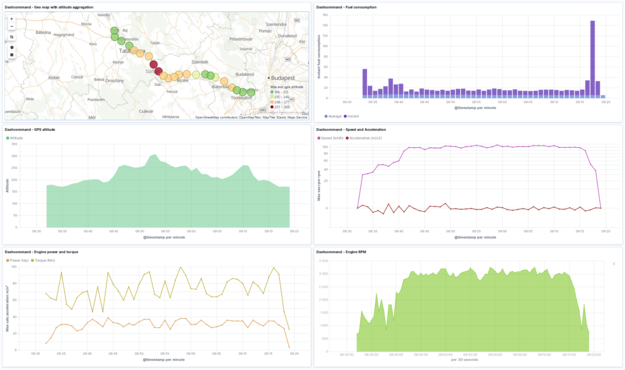
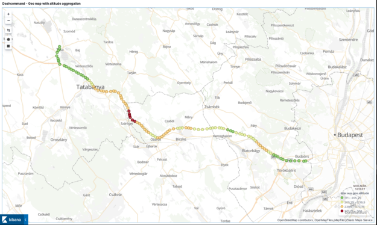
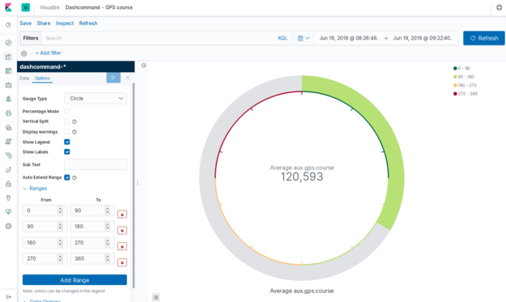
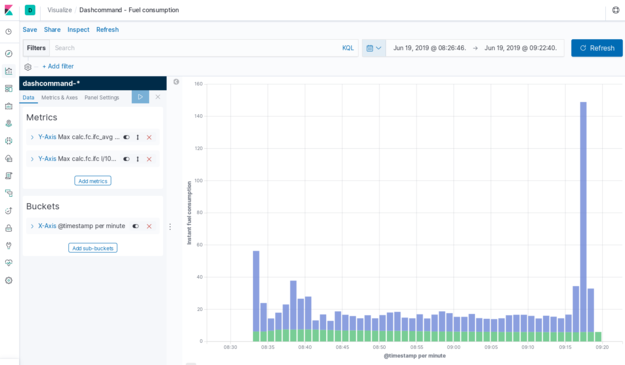

It is an experiment about displaying OBD2 car metrics in Elasticsearch. To see how fuel economy changes by changing your driving habits.
With the help of an ELM327 compatible OBD2 reader and a Android app [Dashcommand](https://play.google.com/store/apps/details?id=com.palmerperformance.DashCommand&hl=en) I could export OBD2 car metrics in Elasticsearch. The app also added GPS data. It was not as easy as it looked like at the beginning.

## What is OBD2 car metrics?

OBD and OBD2 are standards for [on-board diagnostics](https://en.wikipedia.org/wiki/On-board_diagnostics) of various vehicles like cars and trucks. Basically it is an interface for the car's brain. With an OBD2 adapter you can query the status and metrics of various subsystems of a vehicle. You can find this port in almost any car manufactured in the last three decades.

This interface usually is not used by customers but by experienced car mechanics or technicians. There are many apps which can use an [ELM327](https://en.wikipedia.org/wiki/ELM327) adapter to read data,  some even claim to clear Check Engine light too. However these cheap adapters are not comparable to professional devices which in are usually much more expensive and can do a lot more.

I have seen such professional devices which can even draw diagrams of metrics in real time. I though somehow the basics should be possible with Elasticsearch as well. Maybe not in real time. :)

## What OBD2 car metrics can we get?

I drive a lot. Therefore one of my main motivation is to improve my fuel economy to simply save costs. I wanted to read the following metrics from my car.

- Speed

- Acceleration

- Fuel consumption (actual, average)

- Engine RPM, power and torque (the last two are calculated values)

- GPS latitude, longitude and altitude

Different apps were tested before but most of them either did not support exporting OBD2 car metrics nor could add GPS data to the metrics. I even put some effort to use [Carscanner](https://play.google.com/store/apps/details?id=com.ovz.carscanner&hl=en) and [Trackbook GPS](https://play.google.com/store/apps/details?id=org.y20k.trackbook&hl=en) together but although correlating data from two different apps **was fun**, but the results was not satisfying for at all. Creating an app from scratch was not an option as I wanted to focus my resources on visualization and understanding the data and not on developing an app.

After some trials I found two possible solutions. One of them was [AutoPi](https://www.autopi.io/), which looked very promising but it was too expensive (275 EUR) for the task. The other one was [Dashcommand](https://play.google.com/store/apps/details?id=com.palmerperformance.DashCommand&hl=en) which turned out absolutely worth the money (~ 7 EUR) for such a hobby project. It is capable to record much more data and metrics than I needed.

(I am really sorry AutoPi. I admit that I found you cooler than Dashcommand.)

## Dashcommand

### Basic usage

After you completed the first run wizard, specified your car's details, you should go to Settings and check "Enable GPS". On the main screen tap on DATA GRID and click on the computer icon to start recording metrics.

Once you stopped recording you should check LOG FILES on the main screen and export the logs as CSV files (spreadsheet file). Depending on the length of your track it will take some time to prepare the data and save it for you. Transfer it to your computer.

### Processing the exported data

We have the CSV file but in its current format it is just a really huge mass of numeric data. Therefore I needed a tool to convert it into a format what Elasticsearch can ingest. I have developed a script in Perl using the [Search::Elasticsearch](https://metacpan.org/pod/Search::Elasticsearch) library to send the records in the appropriate format to Elasticsearch.

Before you would use the script the index template mapping needs to be set in Elasticsearch. The procedure [has been already described in my previous posts](/visualizing-fail2ban-logs-in-kibana/#Create_index_template_for_Fail2ban_in_Elasticsearch). You can [download the index template mapping](https://github.com/abalage/balagetech-dashcommand-parser-obd-elasticsearch/blob/master/elastic/index-mapping-dashcommand.txt) from GitHub. After the mapping is added you can [use the script](https://github.com/abalage/balagetech-dashcommand-parser-obd-elasticsearch/blob/master/dashcommand-csv-parser.pl).

The script requires a "-d" switch pointing to the CSV file you want to process and an "-e" switch pointing your Elasticsearch ingest node.

```
$ perl dashcommand-csv-parser.pl -d DataLog.csv -e 1.2.3.4:9200 2>/dev/null
```

In the example above I muted stderr as it gets polluted by the [trace messages of Search::Elasticsearch library that I could not turn off](https://metacpan.org/pod/Search::Elasticsearch#trace_to).

Please note, the resulted documents will not be consistent in terms of available key-value pairs. The reason is that not all metrics are available in every frame. This is expected. A sample document looks like this.

```
{
  "_index": "dashcommand-2019-06-19",
  "_type": "_doc",
  "_id": "pQfBk2sB4oJcycVygM3v",
  "_version": 1,
  "_score": null,
  "_source": {
    "calc.fuel_flow_avg l/h": "4.306",
    "calc.acceleration_g g": "-0.000",
    "@timestamp": "2019-06-19T07:19:17",
    "sae.maf g/s": "2.06",
    "calc.fc.ifc_avg l/100km": "5.9",
    "sae.vss km/h": "0",
    "calc.map kpa": "31.6",
    "frame number": "8134",
    "calc.fuel_flow l/h": "0.704",
    "calc.engine_power hp": "2",
    "calc.distance km": "242.4",
    "calc.acceleration m/s²": "-0.000",
    "sae.iat °c": "38",
    "calc.engine_torque n·m | kg-f·m": "25",
    "sae.rpm rpm": "716",
    "calc.boost_pressure kpa | bar | kg-f/cm²": "-0.674",
    "sae.sparkadv °": "3.0"
  },
  "fields": {
    "@timestamp": [
      "2019-06-19T07:19:17.000Z"
    ]
  }
}
```

### Further readings about OBD data and metrics

If you are interested in about what these metrics mean. I highly suggest to check the following links. I found them really helpful during my work.

- [EXTRACTION AND ANALYSIS OF CAR DRIVING DATA VIA OBD-II](http://lcsi.umh.es/docs/pfcs/PFC_TFG_Bocanegra_Fernando.pdf) by Fernando Bocanegra Gallardo - (Chapter 5. Analysis)

- [Consumption calculation of vehicles using OBD data](https://www3.epa.gov/ttn/chief/conference/ei20/session8/aalessandrini_pres.pdf) by Adriano Alessandrini, Francesco Filippi, Fernando Ortenzi

- [CALC\_PID\_Reference.pdf](https://www.palmerperformance.com/download/CALC_PID_Reference.pdf) - by Palmer Performance, vendor of Dashcommand

- [Vehicle\_Settings.pdf](https://www.palmerperformance.com/download/Vehicle_Settings.pdf) - by Palmer Performance, vendor of Dashcommand

## Elasticsearch and Kibana

All these stuff means nothing without shiny visualizations right?

[](/assets/uploads/2019/07/obd-dashboard-elasticsearch-1250.png)Dashboard showing all the metrics I mentioned at the beginning.

### Visualizing GPS altitude in Kibana

Here is a tricky one. In my previous posts like in [NGINX visualization](/visualizing-nginx-access-logs-kibana/#Creating_a_Coordinate_Map_visualization_for_GeoIP_data_of_HTTP_clients), or [Fail2ban visualization](/visualizing-fail2ban-logs-in-kibana/#Visualizing_Fail2ban_logs_in_Kibana) I have shown that in Kibana you can easily visualize locations by the latitude and longitude data. But what about altitude?

Change the aggregation type from the default **Count** to **Max** and the field to **aux.gps.altitude**. It will effectively show the maximum value of the altitude. The value actually reflects the geological altitude on the map. It is sad that the map visualization is only 2D.

[](/assets/uploads/2019/07/obd-altitude-elasticsearch-1250.png)Tip: Do the same trick with line charts with chart type set to area. It will look like a cross-section of a map.

### Where is North?

The GPS records contain the actual GPS course too. By using the Gauge visualization and a narrow enough time interval you can actually see your direction. You have to set up at least 4 ranges according to a 360 degrees circle. It is a bit quirky I know. If you set up more ranges, then it will look like as a compass.[](/assets/uploads/2019/07/obd-north-elasticsearch-1250.png) 

### How my fuel consumption looked like?

As we have almost all OBD2 car metrics in Elasticsearch, we can put both average and instantaneous fuel consumption on a [stacked bar chart](/simplified-logging-docker-elasticsearch-syslog-ng/#Creating_a_stacked_Vertical_Bar_visualization).

[](/assets/uploads/2019/07/obd-fuel-consumption-elasticsearch-1250.png)Looks like I had a moment of full throttle at the end of my trip. :)

## Verdict

Should you like to see your car's data in Elasticsearch, then download all visualizations and dashboards from [the projects GitHub repository](https://github.com/abalage/balagetech-dashcommand-parser-obd-elasticsearch). I only tested the script under Linux. It may or may not work under Windows. It is time to give your car a ride. :)
