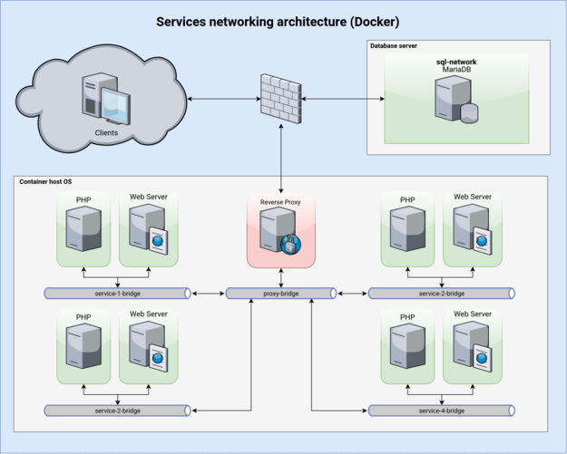
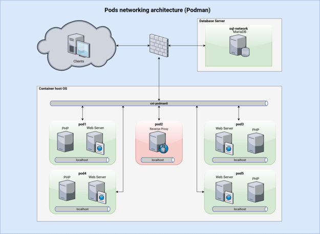
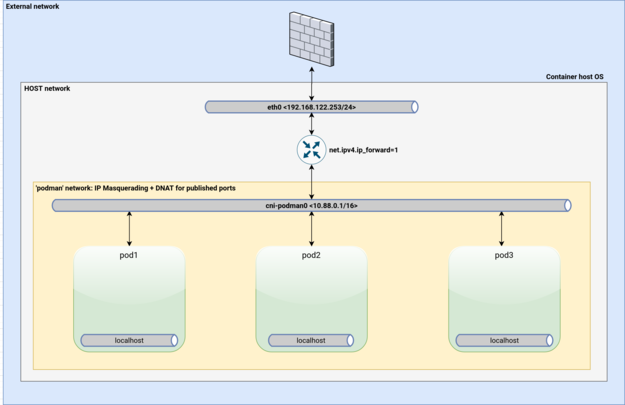

How to deploy pods with Podman when you only need a single-host system and not a complex Kubernetes. Convert your docker-compose services to pods with Podman.

For a single host setup or even for [a now officially dead](https://www.reddit.com/r/docker/comments/es1kxr/future_of_docker_swarm/) Docker Swarm setup using docker-compose is pretty convenient. But I wanted to get rid of Docker completely and migrate my docker-compose services to pods with Podman.

## The reasons why I convert docker-compose services to pods

I have been using Docker's container technology for about 4-5 years. Both in production and in different labs. Call me an old fashioned but I always managed to set up systems either with pure Docker containers or with docker-compose. However there are things I cannot easily forget.

Here are the top reasons why I decided to convert my docker-compose services to pods with Podman and get rid of Docker completely.

- Closing issues with an attitude of 'we don't really care'. Like [#4513](https://github.com/docker/compose/issues/4513), or [#22920#issuecomment-264036710](https://github.com/moby/moby/issues/22920#issuecomment-264036710)

- Leaving important security requests open for years. Like [#3480#issuecomment-482587531](https://github.com/docker/compose/issues/3480#issuecomment-482587531).

- Recurring errors like failing to create many bridged network at once on a clean system, claiming '*ERROR: Pool overlaps with other one on this address space*'. 

- Too many fiddling with iptables rules on a system using firewalld. This may not be a problem where a host OS' only role is to run containers. But there are legit cases where containers may run on a host serving other purposes as well.

- Daemon changes causing data losses. I learned the hard way why putting a production SQL database (state-full) into a container is a NO GO.

- Inconsistency between recommendations and real life experience. Like "**Don’t run more than one process in a single container**" - Have you seen GitLab's official [Docker image](https://docs.gitlab.com/omnibus/docker/)?

- Various issues with logging. Some of them are already explained in posts like [top 10 Docker logging gotchas](https://dzone.com/articles/top-10-docker-logging-gotchas).

I know some of these reasons may not apply to recent versions of Docker. And I am also aware that some issues are container technology related, so they may apply to Podman containers as well.

## The basis of migration

Any migration requires planning and testing. So I started off with my home lab which hosts different systems. In my lab docker-compose took care of composing all services with a single YAML file. The following simplified figure shows a high level overview of the network architecture. Although the picture may indicate, the reverse proxy is not the gateway for the containers.

<figure class="wp-block-image size-large">[](/assets/uploads/2020/02/docker-compose-network-diagram-2-625.png)<figcaption>Figure 1: Network architecture of services orchestrated by docker-compose</figcaption></figure>   

Although this system worked pretty well, I have some issues with it. 

1. All networks use a bridge network driver to provide network isolation of service groups. Therefore you have to create many networks, which in turn improves complexity.

1. The network of `Reverse Proxy` has to be literally connected to all other bridges to have access to the web servers. **However, this way the proxy container could access all exposed ports of all containers on any networks the proxy container is attached to.** It provides a bigger attack surface.

1. Docker makes these networking possible with lots of iptables rules (so as Podman) which are hard to overview and pollute the iptables rules you may already have.

## Planning the conversion of docker-compose services to pods

There is a very fundamental difference between Docker and Podman. [Podman supports the concepts of pods](https://developers.redhat.com/blog/2019/01/15/podman-managing-containers-pods/) for instance. This is intentionally very similar to Kubernetes' pods. Containers in a pod shares the same namespace, like network. So all containers in the same pod looks like sharing the same `localhost` network. And each pod has its own localhost. 

With Docker (Figure 1) there are 5 networks for 9 containers. With Podman by using pods there is only 1 network for 5 pods (Figure 2).

<figure class="wp-block-image size-large">[](/assets/uploads/2020/02/podman-network-diagram-2-625.png)<figcaption>Figure 2: Network architecture of services orchestrated by Podman</figcaption></figure>   

Pods provide another layer of isolation I really like. **This way containers of any pods could only access ports published by other pods and not the containers themselves.**

## Challenges with Podman

Migrating to a new technology is not without compromises or challenges. Podman is around for a while and is rapidly evolving. Here are the challenges I had to handle.

### Assign IP addresses to pods and not to containers

You can join a container to any networks. But a pod [can be only joined to the default network](https://github.com/containers/libpod/issues/4718). According to my understanding this will be changed later. This is the reason why I stick to the default network in my setup.

> "Most of the attributes that make up the Pod are actually assigned to the “infra” container.  Port bindings, cgroup-parent values, and kernel namespaces are all assigned to the “infra” container. "

> https://developers.redhat.com/blog/2019/01/15/podman-managing-containers-pods/

By default pods will connect to network labeled `cni\_default\_network` in `libpod.conf`. If you join the pod's containers to other networks, the pod will still have its IP assigned from the default network. However containers will have IPs assigned from the specified networks. As far as I know this symptom [looks like a bug](https://github.com/containers/libpod/issues/4908#issuecomment-577187947). 

### DNS name resolution between containers and pods

By using the container plugin [dnsname](https://github.com/containers/dnsname) you can get name resolution between containers on the same network. However at the moment you cannot have DNS between pods. [That feature is under development.](https://github.com/containers/dnsname/issues/11)

While I am waiting for support of DNS on pod level, I worked around this limitation. I publish the exposed ports of pods to their gateway's IP address 10.88.0.1 and not the IP address of their infra container itself. As long as the gateway's IP address static this will work.

## Replacing functionalities of docker-compose

The YAML format of docker-compose uses an abstraction above '`docker run`' command. However I realized that all the hard work docker-compose did to me was to create networks and assign container's to them. And of course deploying services.

### Networking: Rootfull container networking (CNI)

Luckily describing how a network should look like is not the role of Podman but [CNI and its plugins](https://github.com/containernetworking/plugins). You can see the layout of the default network in Figure 3.

<figure class="wp-block-image size-large">[](/assets/uploads/2020/02/podman-network-diagram-hld-625.png)<figcaption>Figure 3. Low level network topology of Podman's default network, called 'podman'.</figcaption></figure>   

The published ports are not visible from the outside network unless you set up routes externally. Or you can simply set the IP address of the host for serving published ports (`--publish 192.168.122.253:80:80`). Effectively it will be another DNAT rule. For my simple case it is enough.

P.s. Do not forget to enable IP forwarding with sysctl to persist across reboots.

P.s. 2: You may need to change the default firewall backend from iptables to firewalld in CNI configuration. So you will have a cleaner overview of your chains and rules.

*Rootless containers uses [slirp4netns](https://github.com/rootless-containers/slirp4netns) instead of CNI. You can read more about the differences in this post [configuring container networking with Podman](http://Configuring container networking with Podman).*

### Build images: use Dockefile to build an image

I really like that you do not have to learn another language to build an image. Use the same Dockerfile format you are already familiar with.

Building an image is not the task of Podman but another tool called [buildah](https://developers.redhat.com/blog/2019/02/21/podman-and-buildah-for-docker-users/). Although you can even use `podman build`, it will actually use Buildah in the background. Assuming you have your Dockerfile in the current working directory, it will look like this. It can even publish the image to a Docker repository.

```
buildah pull docker.io/opensuse/leap:15.1
buildah bud -t example/example-container:latest .
```

### Deployment: Managing container life-cycles

Docker-compose made it possible to deploy all services at once with `docker-compose up -d`. Achieving the same with Podman is possibly by using its [support for Kubernetes YAML](https://developers.redhat.com/blog/2019/01/29/podman-kubernetes-yaml/) and some shell scripting. 

1. Set up the pods and containers with all the settings you need with plain `podman run` commands. Here is a shell script example for [gitea](https://gitea.io).  

```
#!/bin/bash
podname="gitea"
version="1.9"
publish_ip="10.88.0.1"

podman pod rm -f ${podname} podman pod create --name ${podname} --hostname ${podname} -p ${publish_ip}:3000:3000

podman run -d --name ${podname}-svc --hostname ${podname}-svc --expose 3000 --pod ${podname} -e TZ="Europe/Budapest" \
 -v /srv/${podname}:/data \
 gitea/gitea:${version}
```

1. Generate a Kubernetes compatible YAML file.  

```
podman generate kube -f gitea.yml gitea
```

1. Replay it.  

```
podman pod rm -f gitea podman play kube gitea.yml
```

I wrote a wrapper script called [pods-compose](https://github.com/abalage/pods-compose) for imitating docker-compose start/stop/up/down but for pods to easy my life. There is a already post about [managing Podman pods with pods compose.](/2020/03/31/managing-podman-pods-with-pods-compose/)

## Final thoughts

I did a lot of testing, so I managed to convert all docker-compose services to pods with Podman and with some shell scripting. I still have to figure out how to auto start of pods. There are [shareable systemd devices for containers](https://www.redhat.com/sysadmin/podman-shareable-systemd-services), but I want to test it for pods. See you next time.
