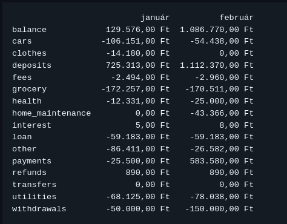

Introducing '****[whatsthedamage](https://github.com/abalage/whatsthedamage)' - a tool to process your bank account exports. I share my journey of creating this tool in Python, the challenges I encountered, and how AI helped along the way. 

Managing personal finances can be a bit of a headache, especially when it comes to turning bank account exports into useful reports.</

I found that many existing software options just didn’t meet my needs. Either they had high learning curves, like using double accounting, or having constant maintenance burden.

So, I decided to take matters into my own hands and develop a solution tailored to my specific needs. [Can an AI code assistant help me along the way?](#verdict) Let's find out!

## Are my needs really special?

There are dozens of fintech companies and software that promise to give you insights and other services once you give them access to your bank account details.

However, I consider my financial details to be a private matter between myself and my chosen bank. To process my bank account exports **I require a solution to process the data only I have access to. **This includes the exporting functionality of my internet bank to get historical data saved into CSV files.

Speaking of CSV exports, I have already tested [Firefly III](https://www.firefly-iii.org/) which looked promising but requires you to know how double accounting works and to have data from all your accounts. I also found its rule engine a bit harder to use.</

I also tested [Actual Budget](https://actualbudget.org/) which has a different concept. However, I found it harder to use for existing transaction histories. Especially when you want to have reports about transactions going back for years.

Should you quickly want to find out what ****[whatsthedamage](https://github.com/abalage/whatsthedamage) is capable of, check the [introduction of "whatsthedamage"](#whatsthedamage).

## Improve Python skills by creating software from scratch

I have been using Python for a couple of years now to create scripts to automate stuff. Such as [processing IP block lists to create firewalld rules](https://github.com/abalage/blocklist-firewalld). Or a silly attempt to [fill the gap between docker-compose and podman](https://github.com/abalage/pods-compose). But I also wanted an open source project that I could proudly share with the audience. A tool to process your CSV bank account exports also might be useful for others.

### Deliver faster by using an AI code assistant

I was somewhat frustrated that I had to write a complete software to process my CSV bank account exports. So I expected probably hours of googling and reading to know how to do stuff like static code analysis, writing test cases for Python or even how to package it. You may know that **the first step is usually the hardest**.

At the same time I was also curious whether can I use some AI code assistant to reduce the learning time and deliver faster. So I could just get started without the overwhelming feeling of investing a lot of resources upfront.

### Specifying high level requirements

For getting what you want, you need to know what you want. High level designs are somewhat required. You need to have a clear picture of what you really expect from the tool. Here are my high level requirements.

- Work on CSV exports containing historical transactions, even going back for years.

- Categorize transactions into well known categories like purchases, transfers, deposits, etc.

- Add user defined categories like groceries, mortgage, cars, house maintenance, etc.

- Be able to categorize transactions based on user-defined regular expressions.

- Summarize amounts per categories.

- Filter transactions per interval.

- Provide results in a format which is easy to understand.

- Provide results in CSV format.

### Specifying low level requirements

High-level requirements need to be translated into lower-level requirements. Even if I ask an AI service to create code for me I have to tell it what to do. So I broke down the high-level requirements into manageable pieces. Here are some examples below.

- Create a class called CsvFileReader that is responsible for reading a CSV file and storing the headers and rows separately.

- Each row in a CSV file should be a separate object in the CsvRow class, containing the row contents as key-value pairs using the keys from the headers.

- Use 'argparse' to set up command-line arguments for providing a filename that points to a CSV file.

- Create unit tests using pytest for the DateConverter class.

## Introducing "whatsthedamage" to process your bank exports

Although the [project's GitHub page](https://github.com/abalage/whatsthedamage) contains a lot of information still I would like to highlight the main features it has.

- **Automated Categorization**: Categorizes transactions into well-known accounting categories such as deposits and payments, as well as custom categories using regular expressions.

- **Filtering**: Filter transactions by start and end dates, or group them by month for a comprehensive overview of your finances.

- **Detailed Reporting**: Generate summarized reports that provide insights into your spending habits, grouped by transaction categories.

- **CSV Export**: Save your reports as CSV files for easy sharing and further analysis.

- **Custom configuration: **Use custom configuration to use your own regular expressions.

*Filtered report from January and February*

Install and usage instructions can be found on [whatsthedamage's project page](https://github.com/abalage/whatsthedamage).

### What about the maintenance burden?

I mentioned earlier that I was not really fond of the rules engines of Firefly III and Actual Budget. I do not want to reinvent the wheel and I want something which is easier to use, thus I opted for using regular expressions.

Does it solve all the problems of maintenance requirements the other tools have? Certainly no. Complexity has to live somewhere. :)

Is it better than the others? For me it is. Writing regexps is easier for me than creating a complex rule engine.

For people not experienced in writing regular expressions, I provide a [default configuration](https://github.com/abalage/whatsthedamage/blob/main/config.json.default) having patterns for many well known retail chains available in Hungary.

## My experiences with Copilot and ChatGPT

I mentioned earlier that most of the code in [whatsthedamage](https://github.com/abalage/whatsthedamage) was created with the help of Copilot and ChatGPT. Either by directly creating code from scratch (like most of the unit tests and documentation), or iterating over codes written by me but asked Copilot to review it and possibly provide improvements.

*At the time I am writing this post, both Copilot and ChatGPT (free tier) use the GPT-4o model.* 

### These are the positive remarks I made during the development.

- Some responses were surprisingly good and worked as is. There were even cases when it added functionalities I was just about to explicitly ask for. It was as if it were reading your mind. I am not kidding sometimes I even dropped my jaw.

- The learning speed by using "Explain" and in situations like "Show me how to achieve this specific task in pyproject.toml" was sometimes really overwhelming. Had I needed to Google it myself, it would have taken much longer.

### And the negative remarks I experienced.

- Adjustments made by AI on reviewed code blocks often resulted in lost comments or indentation problems.

- Suggestions to a problem sometimes contain the very same code that you asked the suggestion for. Line by line.

- If you argue with the AI about the suggestions, it will happily and politely suggest alternatives. But sometimes you realize that it goes round and round and does not really have much of a clue. In such cases usually adjusting the context could help.

## My verdict about the AI code assistant

I found using such a new kind of tool to complete my tasks fascinating and fun to work with. Although I admit that you need to have some level of coding knowledge about Python and programming in general to verify that what you got from the AI is really what you needed.

I do not think it is a silver bullet; however, it considerably helped me to understand new things in a quick and more focused format. Also its "pair programming" approach helped me to spot issues I did and learn new things faster.

After I was mostly done with this post, I ran into the article [The 70% problem: Hard truths about AI-assisted coding](https://addyo.substack.com/p/the-70-problem-hard-truths-about) by Addy Osmani. Addy explains why junior and experienced developers use code assistants differently. I pretty much agree with him. You have to have some level of existing knowledge to use a code assistant effectively, but do not forget the "Trust but verify" pattern.

*Full disclosure: Microsoft Designer were used to create the picture for this blog, so as ChatGPT was used for proof reading. The python code were created with the help of Copilot.
*
